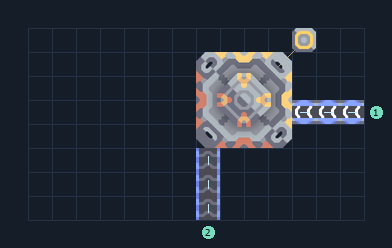

# ส่ง เมตากลาส จากสายผลิต

**CARGO-BELT-metaglass** · 08 ส่งรับ v8 · 14×8 ช่อง · **ทดสอบระบบ**

ส่งทรัพยากร เมตากลาส  
Advanced Launch Pad 1 แท่น ส่ง 100 ชิ้น/30 วินาที ต้องมีน้ำมัน 9/วินาทีและไฟ 480/วินาที  
ป้อนสินค้าเข้าเส้นเดียวที่ขอบล่าง  
ให้โฮสต์เลือกปลายทาง ปลายทางใช้ค่าเดียวร่วมทั้งเซกเตอร์  
  
เข้า น้ำมัน ที่ (13,4) 9/วินาที  
เชื่อมไฟที่เสา (11,7)  
เข้า เมตากลาส ที่ (7,0) อย่างน้อย 3.34/วินาที  
พิกัดจากซ้ายล่างเริ่ม 0 ก่อนหมุน  
ใช้ไฟสูงสุดตามสูตรรวมประมาณ 480/วินาทีเมื่อเครื่องทำงานพร้อมกัน  
  
ผลทดสอบ Build 160.7: ส่งจริง 1000 ชิ้นใน 300 วินาที; น้ำมันและไฟไหลผ่านระบบตามจุดต่อ  
  
หมวด: 08 ส่งรับ v8 • Serpulo ไทย 2.0

**วัสดุก่อสร้าง:** ทองแดง 355 · ตะกั่ว 309 · เมตากลาส 3 · ซิลิคอน 250 · ไทเทเนียม 209

[ดาวน์โหลด .msch](../../schematics/CARGO-BELT-metaglass.msch) · [รหัสนำเข้าจากคลิปบอร์ด](../../codes/CARGO-BELT-metaglass.txt) · [กลับสารบัญ](../INDEX.md)

ภาพประกอบใช้กราฟิกบล็อกจากตัวเกม ไม่ใช่ภาพการรบระหว่างเล่นจริง ทางป้อนต้องจ่ายวัตถุดิบและไฟตามเงื่อนไขที่ระบุ
