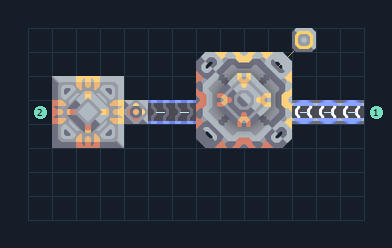

# ส่ง ตะกั่ว จากคลังแนบ Core

**CARGO-CORE-lead** · 08 ส่งรับ v8 · 14×8 ช่อง · **ทดสอบระบบ**

ส่งทรัพยากร ตะกั่ว  
Advanced Launch Pad 1 แท่น ส่ง 100 ชิ้น/30 วินาที ต้องมีน้ำมัน 9/วินาทีและไฟ 480/วินาที  
วาง Vault ด้านซ้ายให้สัมผัส Core ที่มีอยู่; Unloader เลือกสินค้าไว้แล้ว ระวังดึงทรัพยากรจน Core หมด ใช้เป็นโมดูลส่งเฉพาะฐานผลิตที่มีสำรอง  
ให้โฮสต์เลือกปลายทาง ปลายทางใช้ค่าเดียวร่วมทั้งเซกเตอร์  
  
เข้า น้ำมัน ที่ (13,4) 9/วินาที  
เชื่อมไฟที่เสา (11,7)  
เข้า ตะกั่ว ที่ (1,4) เติมคลัง/แนบ Core; ช่องซ้ายใช้กับทดสอบ  
พิกัดจากซ้ายล่างเริ่ม 0 ก่อนหมุน  
ใช้ไฟสูงสุดตามสูตรรวมประมาณ 480/วินาทีเมื่อเครื่องทำงานพร้อมกัน  
  
ผลทดสอบ Build 160.7: ส่งจริง 1000 ชิ้นใน 300 วินาที; น้ำมันและไฟไหลผ่านระบบตามจุดต่อ  
  
หมวด: 08 ส่งรับ v8 • Serpulo ไทย 2.0

**วัสดุก่อสร้าง:** ทองแดง 354 · ตะกั่ว 308 · เมตากลาส 3 · ซิลิคอน 280 · ทอเรียม 125 · ไทเทเนียม 483

[ดาวน์โหลด .msch](../../schematics/CARGO-CORE-lead.msch) · [รหัสนำเข้าจากคลิปบอร์ด](../../codes/CARGO-CORE-lead.txt) · [กลับสารบัญ](../INDEX.md)

ภาพประกอบใช้กราฟิกบล็อกจากตัวเกม ไม่ใช่ภาพการรบระหว่างเล่นจริง ทางป้อนต้องจ่ายวัตถุดิบและไฟตามเงื่อนไขที่ระบุ
