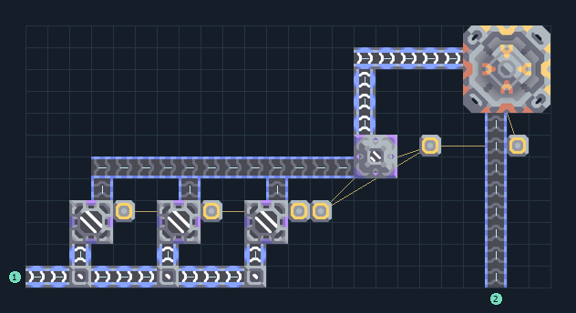

# ฐานส่งพร้อมผลิตน้ำมันจากสปอร์

**CARGO-OIL-START** · 08 ส่งรับ v8 · 24×12 ช่อง · **ทดสอบระบบ**

เริ่มส่ง 200/นาที  
ผลิตน้ำมันจาก Cultivator 3 เครื่องและ Spore Press 1 เครื่อง แล้วจ่ายให้ Advanced Launch Pad 1 แท่น  
รับน้ำภายนอกอย่างน้อย 54/วินาทีที่ประสิทธิภาพพื้น 100%; ใช้ไฟภายนอกและสินค้า 3.34/วินาที  
ให้โฮสต์ตั้งปลายทางเซกเตอร์; ป้อนสินค้าเพียงชนิดเดียวต่อแท่น; เริ่มจากเครื่องว่างได้เมื่อมีไฟและน้ำ  
  
เข้า น้ำ ที่ (0,0) อย่างน้อย 54/วินาที  
เข้า ซิลิคอน ที่ (21,0) เลือกสินค้าอื่นได้; ทดสอบด้วยซิลิคอน  
เชื่อมไฟที่เสา (13,3)  
พิกัดจากซ้ายล่างเริ่ม 0 ก่อนหมุน  
ใช้ไฟสูงสุดตามสูตรรวมประมาณ 762/วินาทีเมื่อเครื่องทำงานพร้อมกัน  
  
ผลทดสอบ Build 160.7: ส่งจริง 2000 ชิ้นใน 600 วินาที; น้ำมันและไฟไหลผ่านระบบตามจุดต่อ  
  
หมวด: 08 ส่งรับ v8 • Serpulo ไทย 2.0

**วัสดุก่อสร้าง:** ทองแดง 460 · กราไฟต์ 12 · ตะกั่ว 469 · เมตากลาส 25 · ซิลิคอน 310 · ไทเทเนียม 261

[ดาวน์โหลด .msch](../../schematics/CARGO-OIL-START.msch) · [รหัสนำเข้าจากคลิปบอร์ด](../../codes/CARGO-OIL-START.txt) · [กลับสารบัญ](../INDEX.md)

ภาพประกอบใช้กราฟิกบล็อกจากตัวเกม ไม่ใช่ภาพการรบระหว่างเล่นจริง ทางป้อนต้องจ่ายวัตถุดิบและไฟตามเงื่อนไขที่ระบุ
