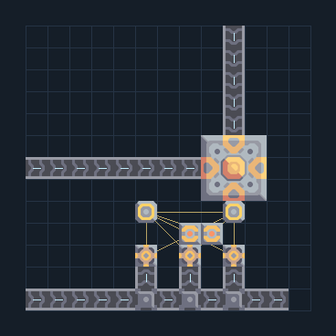

# ฐาน Shard เริ่มต้น — ถ่านหินและรับแร่สองทาง

**CORE-START-COAL** · 01 เริ่มฐานและ Core · 13×13 ช่อง · **ทดสอบระบบ**

ฐานแคมเปญเทคพื้นฐาน ใช้เฉพาะทองแดงและตะกั่วก่อสร้าง  
เลือกเป็นฐานตอน launch หลังวิจัยไฟถ่านหิน เสา แบตเตอรี่และสายพาน; ป้อนถ่านหินจากเหมืองเข้าสายล่าง (0,0) ให้เครื่องไฟสามตัว ป้อนทองแดง/แร่จากเหมืองเข้าซ้าย (0,6) และตะกั่ว/แร่อีกชนิดเข้าบน (9,12) ทั้งสองสายเข้า Core; ต่อไฟออกที่เสา (9,4) แบบไม่ขุดแร่ในตัวและไม่ต้องใช้ไฟเริ่มต้น  
  
จุดต่อก่อนหมุน (0,0 มุมซ้ายล่าง):  
เข้า ถ่านหิน จากเหมืองภายนอก @ 0,0  
เข้า ทองแดง/ทรัพยากรจากเหมืองทางซ้าย @ 0,6  
เข้า ตะกั่ว/ทรัพยากรจากเหมืองทางบน @ 9,12  
ไฟออกไปฐาน; รอถ่านหินถึงเครื่องไฟ @ 9,4  
Serpulo • ไทย 2.0 • บล็อกเดิม • สร้างใหม่  
  
ผลทดสอบ Build 160.7: ผลิตไฟรวมเฉลี่ย 180/วินาทีในการทดสอบ 300 วินาที; เหลือหลังโหลดภายในประมาณ 180/วินาที; ฝากทองแดง/ตะกั่วเข้า Core อย่างละ 5.0/วินาทีจากทางป้อนภายนอก  
  
หมวด: 01 เริ่มฐานและ Core • Serpulo ไทย 2.0

**วัสดุก่อสร้าง:** ทองแดง 1123 · ตะกั่ว 897

[ดาวน์โหลด .msch](../../schematics/CORE-START-COAL.msch) · [รหัสนำเข้าจากคลิปบอร์ด](../../codes/CORE-START-COAL.txt) · [กลับสารบัญ](../INDEX.md)

ภาพประกอบใช้กราฟิกบล็อกจากตัวเกม ไม่ใช่ภาพการรบระหว่างเล่นจริง ทางป้อนต้องจ่ายวัตถุดิบและไฟตามเงื่อนไขที่ระบุ
