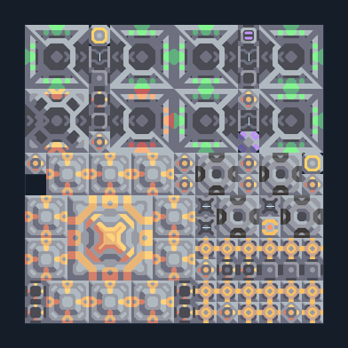

# ฐาน Foundation — ไฟและยูนิต T2

**CORE101** · 01 เริ่มฐานและ Core · 14×14 ช่อง · **ตรวจผัง**

แผนลงฐานกลางเกมพร้อมโรงงานและไฟถ่านหิน  
ใช้เลือกฐานตอน launch แคมเปญเมื่อปลดล็อก Core Foundation; เตรียมถ่านหิน/ตะกั่ว/ทราย/ซิลิคอน/กราไฟต์ตามสูตรใน Core; ตรวจโรงงานตั้งค่าชนิดยูนิตหลังลง  
มี mlog เดิมฝังในแบบ: ห้ามลบ processor หากยังใช้ระบบอัตโนมัติ; ดูวิธีตั้งค่าของผู้สร้างในคู่มือฉบับเต็ม  
  
แหล่ง: Design-It / justacommonegg  
ต้นฉบับ: T2 Core Launch Foundation v1.3  
MIT; แปลชื่อและคู่มือโดยชุด Serpulo ไทย 2.0  
อ่าน/โครงสร้างผ่านแล้ว ผลทดสอบการทำงานเฉพาะรหัสอยู่ในคู่มือ อัตราจริงขึ้นกับแผนที่และวัตถุดิบ  
  
หมวด: 01 เริ่มฐานและ Core • Serpulo ไทย 2.0

**วัสดุก่อสร้าง:** ทองแดง 4289 · กราไฟต์ 5 · ตะกั่ว 4118 · ซิลิคอน 2910 · ไทเทเนียม 1275

[ดาวน์โหลด .msch](../../schematics/CORE101.msch) · [รหัสนำเข้าจากคลิปบอร์ด](../../codes/CORE101.txt) · [กลับสารบัญ](../INDEX.md)

ภาพประกอบใช้กราฟิกบล็อกจากตัวเกม ไม่ใช่ภาพการรบระหว่างเล่นจริง ทางป้อนต้องจ่ายวัตถุดิบและไฟตามเงื่อนไขที่ระบุ
