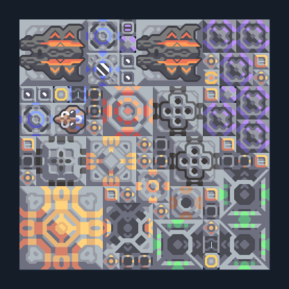

# ฐาน Nucleus — Spectre RTG และ Poly

**CORE102** · 01 เริ่มฐานและ Core · 15×15 ช่อง · **ตรวจผัง**

แผนลงฐานท้ายเกมพร้อมไฟ ป้องกัน และช่วยก่อสร้าง  
เลือกฐาน launch ของแคมเปญเมื่อวิจัยครบ มี Spectre/RTG/Poly และโรงงานในตัว ต้องเตรียมทอเรียมและวัตถุดิบยูนิต/โรงงานใน Core; ตรวจฐานป้อนน้ำและเชื้อเพลิงก่อนรับเวฟ  
มี mlog เดิมฝังในแบบ: ห้ามลบ processor หากยังใช้ระบบอัตโนมัติ; ดูวิธีตั้งค่าของผู้สร้างในคู่มือฉบับเต็ม  
  
แหล่ง: Design-It / justacommonegg  
ต้นฉบับ: Core Nucleus Spectre Rtg Poly PayEnter  
MIT; แปลชื่อและคู่มือโดยชุด Serpulo ไทย 2.0  
อ่าน/โครงสร้างผ่านแล้ว ผลทดสอบการทำงานเฉพาะรหัสอยู่ในคู่มือ อัตราจริงขึ้นกับแผนที่และวัตถุดิบ  
  
เป้าหมายป้อม: spectre → พื้นดินและอากาศ; wave → พื้นดินและอากาศ  
  
หมวด: 01 เริ่มฐานและ Core • Serpulo ไทย 2.0

**วัสดุก่อสร้าง:** ทองแดง 10593 · กราไฟต์ 831 · ตะกั่ว 9708 · เมตากลาส 273 · ผ้าเฟส 185 · พลาสตาเนียม 950 · ซิลิคอน 6484 · เซิร์จอัลลอย 620 · ทอเรียม 4925 · ไทเทเนียม 1031

[ดาวน์โหลด .msch](../../schematics/CORE102.msch) · [รหัสนำเข้าจากคลิปบอร์ด](../../codes/CORE102.txt) · [กลับสารบัญ](../INDEX.md)

ภาพประกอบใช้กราฟิกบล็อกจากตัวเกม ไม่ใช่ภาพการรบระหว่างเล่นจริง ทางป้อนต้องจ่ายวัตถุดิบและไฟตามเงื่อนไขที่ระบุ
