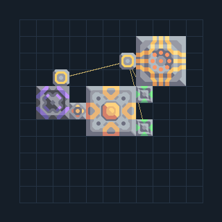

# ฐาน Shard — RTG แบตเตอรี่และซ่อมต้นทาง

**CORE201** · 01 เริ่มฐานและ Core · 11×11 ช่อง · **ตรวจผัง**

แผนลงฐานขนาดเล็กสำหรับเซกเตอร์ที่รับทรัพยากร  
เลือกใช้ตอน launch แคมเปญเมื่อมีวัสดุและ RTG ปลดล็อกแล้ว เติมทอเรียมใน Core ก่อน; มี Unloader ไป RTG และซ่อม ใช้เป็นจุดเริ่มรับสินค้าแล้วขยายโรงงาน/ป้อมภายนอก  
  
จุดต่อก่อนหมุน (0,0 มุมซ้ายล่าง):  
ไฟออกไปฐาน @ 6,8  
ต่อสินค้าที่รับเข้ากับ Core @ 5,7  
Serpulo • ไทย 2.0 • บล็อกเดิม • สร้างใหม่  
สถานะ: โครงสร้าง; ยังไม่ยืนยันการต่อสู้/กำลังผลิตจริง  
  
หมวด: 01 เริ่มฐานและ Core • Serpulo ไทย 2.0

**วัสดุก่อสร้าง:** ทองแดง 1054 · ตะกั่ว 1022 · ผ้าเฟส 25 · พลาสตาเนียม 75 · ซิลิคอน 135 · ทอเรียม 50 · ไทเทเนียม 45

[ดาวน์โหลด .msch](../../schematics/CORE201.msch) · [รหัสนำเข้าจากคลิปบอร์ด](../../codes/CORE201.txt) · [กลับสารบัญ](../INDEX.md)

ภาพประกอบใช้กราฟิกบล็อกจากตัวเกม ไม่ใช่ภาพการรบระหว่างเล่นจริง ทางป้อนต้องจ่ายวัตถุดิบและไฟตามเงื่อนไขที่ระบุ
