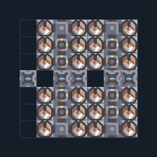

# Duo 24 กระบอก — แนวต้นเกม

**DEF101** · 06 ป้องกัน · 7×7 ช่อง · **ตรวจผัง**

ป้องกันต้นเกมภาคพื้นและอากาศด้วยทองแดง  
ป้อนทองแดงเข้าทางสายพานในภาพ ไม่มีไฟ/ซ่อมในตัว วางกำแพงและชุดซ่อมหน้าฐานเพิ่มเติมตามแนวรบ  
  
แหล่ง: Design-It / .stod  
ต้นฉบับ: Duo Layout  
MIT; แปลชื่อและคู่มือโดยชุด Serpulo ไทย 2.0  
อ่าน/โครงสร้างผ่านแล้ว ผลทดสอบการทำงานเฉพาะรหัสอยู่ในคู่มือ อัตราจริงขึ้นกับแผนที่และวัตถุดิบ  
  
เป้าหมายป้อม: duo → พื้นดินและอากาศ  
  
หมวด: 06 ป้องกัน • Serpulo ไทย 2.0

**วัสดุก่อสร้าง:** ทองแดง 914 · ตะกั่ว 46

[ดาวน์โหลด .msch](../../schematics/DEF101.msch) · [รหัสนำเข้าจากคลิปบอร์ด](../../codes/DEF101.txt) · [กลับสารบัญ](../INDEX.md)

ภาพประกอบใช้กราฟิกบล็อกจากตัวเกม ไม่ใช่ภาพการรบระหว่างเล่นจริง ทางป้อนต้องจ่ายวัตถุดิบและไฟตามเงื่อนไขที่ระบุ
