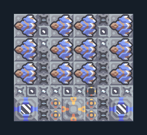

# Salvo 12 กระบอก — กระสุนและหล่อเย็นภายนอก

**DEF102** · 06 ป้องกัน · 10×9 ช่อง · **ตรวจผัง**

แนวปืนกลางเกมพร้อมคลังและของเหลว  
ป้อนกระสุนชนิดที่ Salvo ใช้ได้เข้าคลังและน้ำ/ไครโอเข้าถังของเหลว ตรวจ Unloader ให้ตรงกระสุน; เพิ่มกำแพง/ซ่อมฝั่งศัตรู  
  
แหล่ง: Design-It / skyon2  
ต้นฉบับ: salvo 12 anyAmmo extLiQ (90)  
MIT; แปลชื่อและคู่มือโดยชุด Serpulo ไทย 2.0  
อ่าน/โครงสร้างผ่านแล้ว ผลทดสอบการทำงานเฉพาะรหัสอยู่ในคู่มือ อัตราจริงขึ้นกับแผนที่และวัตถุดิบ  
  
เป้าหมายป้อม: salvo → พื้นดินและอากาศ  
  
หมวด: 06 ป้องกัน • Serpulo ไทย 2.0

**วัสดุก่อสร้าง:** ทองแดง 1274 · กราไฟต์ 1012 · ตะกั่ว 74 · เมตากลาส 104 · ซิลิคอน 120 · ไทเทเนียม 820

[ดาวน์โหลด .msch](../../schematics/DEF102.msch) · [รหัสนำเข้าจากคลิปบอร์ด](../../codes/DEF102.txt) · [กลับสารบัญ](../INDEX.md)

ภาพประกอบใช้กราฟิกบล็อกจากตัวเกม ไม่ใช่ภาพการรบระหว่างเล่นจริง ทางป้อนต้องจ่ายวัตถุดิบและไฟตามเงื่อนไขที่ระบุ
