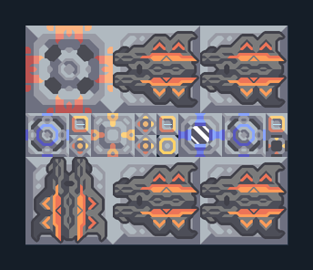

# Spectre 5 กระบอก — ขุดทอเรียมพร้อมน้ำ

**DEF103** · 06 ป้องกัน · 12×10 ช่อง · **ตรวจผัง**

แนวปืนท้ายเกมมีเหมืองกระสุนในตัว  
วาง Airblast บนแร่ทอเรียมและ Water Extractor บนพื้นขุดน้ำได้ ต่อไฟ; ตรวจถังกระสุนและหล่อเย็นก่อนรับศัตรู ใช้ป้อมซ่อมเสริม  
  
แหล่ง: Design-It / justacommonegg  
ต้นฉบับ: Spectre on Thor 05  
MIT; แปลชื่อและคู่มือโดยชุด Serpulo ไทย 2.0  
อ่าน/โครงสร้างผ่านแล้ว ผลทดสอบการทำงานเฉพาะรหัสอยู่ในคู่มือ อัตราจริงขึ้นกับแผนที่และวัตถุดิบ  
  
เป้าหมายป้อม: spectre → พื้นดินและอากาศ  
  
หมวด: 06 ป้องกัน • Serpulo ไทย 2.0

**วัสดุก่อสร้าง:** ทองแดง 4629 · กราไฟต์ 1590 · ตะกั่ว 98 · เมตากลาส 75 · ผ้าเฟส 15 · พลาสตาเนียม 875 · ซิลิคอน 171 · เซิร์จอัลลอย 1250 · ทอเรียม 1325 · ไทเทเนียม 235

[ดาวน์โหลด .msch](../../schematics/DEF103.msch) · [รหัสนำเข้าจากคลิปบอร์ด](../../codes/DEF103.txt) · [กลับสารบัญ](../INDEX.md)

ภาพประกอบใช้กราฟิกบล็อกจากตัวเกม ไม่ใช่ภาพการรบระหว่างเล่นจริง ทางป้อนต้องจ่ายวัตถุดิบและไฟตามเงื่อนไขที่ระบุ
