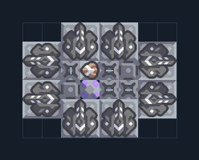

# Scatter 8 กระบอก — โดรนส่งกระสุน

**DEF104** · 06 ป้องกัน · 8×6 ช่อง · **ตรวจผัง**

แนวกันอากาศพร้อมระบบเติมกระสุนด้วยยูนิต  
ต้องมี Core ที่มีตะกั่ว/เมตากลาสและยูนิตส่งของที่ logic เลือกได้ในทีม; อ่านข้อความ processor และเชื่อมตามคู่มือเดิม; หากไม่มียูนิตต้องป้อนกระสุนภายนอก  
มี mlog เดิมฝังในแบบ: ห้ามลบ processor หากยังใช้ระบบอัตโนมัติ; ดูวิธีตั้งค่าของผู้สร้างในคู่มือฉบับเต็ม  
  
แหล่ง: Design-It / y0.  
ต้นฉบับ: Scatter 8  
MIT; แปลชื่อและคู่มือโดยชุด Serpulo ไทย 2.0  
อ่าน/โครงสร้างผ่านแล้ว ผลทดสอบการทำงานเฉพาะรหัสอยู่ในคู่มือ อัตราจริงขึ้นกับแผนที่และวัตถุดิบ  
  
เป้าหมายป้อม: hail → พื้นดิน; scatter → อากาศ  
  
หมวด: 06 ป้องกัน • Serpulo ไทย 2.0

**วัสดุก่อสร้าง:** ทองแดง 840 · กราไฟต์ 17 · ตะกั่ว 434 · ซิลิคอน 50

[ดาวน์โหลด .msch](../../schematics/DEF104.msch) · [รหัสนำเข้าจากคลิปบอร์ด](../../codes/DEF104.txt) · [กลับสารบัญ](../INDEX.md)

ภาพประกอบใช้กราฟิกบล็อกจากตัวเกม ไม่ใช่ภาพการรบระหว่างเล่นจริง ทางป้อนต้องจ่ายวัตถุดิบและไฟตามเงื่อนไขที่ระบุ
