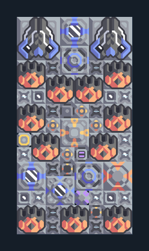

# Swarmer 11 และ Tsunami 2 — เติมด้วยโดรน

**DEF105** · 06 ป้องกัน · 8×15 ช่อง · **ตรวจผัง**

แนวจรวดและของเหลวหยุดศัตรู  
มีน้ำ/ไครโอในตัว ต้องมีไฟ กระสุนที่กำหนดใน Core และยูนิตส่งของสำหรับ logic; ตรวจกระสุนกับถังของเหลวก่อนรับเวฟ ไม่รับประกันกันบอสทุกชนิด  
มี mlog เดิมฝังในแบบ: ห้ามลบ processor หากยังใช้ระบบอัตโนมัติ; ดูวิธีตั้งค่าของผู้สร้างในคู่มือฉบับเต็ม  
  
แหล่ง: Design-It / wpx  
ต้นฉบับ: tsunami swarmers 11  
MIT; แปลชื่อและคู่มือโดยชุด Serpulo ไทย 2.0  
อ่าน/โครงสร้างผ่านแล้ว ผลทดสอบการทำงานเฉพาะรหัสอยู่ในคู่มือ อัตราจริงขึ้นกับแผนที่และวัตถุดิบ  
  
เป้าหมายป้อม: swarmer → พื้นดินและอากาศ; tsunami → พื้นดินและอากาศ  
  
หมวด: 06 ป้องกัน • Serpulo ไทย 2.0

**วัสดุก่อสร้าง:** ทองแดง 212 · กราไฟต์ 498 · ตะกั่ว 1133 · เมตากลาส 362 · พลาสตาเนียม 525 · ซิลิคอน 615 · ทอเรียม 200 · ไทเทเนียม 1240

[ดาวน์โหลด .msch](../../schematics/DEF105.msch) · [รหัสนำเข้าจากคลิปบอร์ด](../../codes/DEF105.txt) · [กลับสารบัญ](../INDEX.md)

ภาพประกอบใช้กราฟิกบล็อกจากตัวเกม ไม่ใช่ภาพการรบระหว่างเล่นจริง ทางป้อนต้องจ่ายวัตถุดิบและไฟตามเงื่อนไขที่ระบุ
