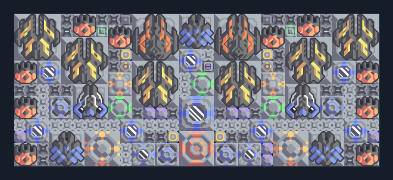

# แนวผสมท้ายเกม — จรวด เลเซอร์ โล่ ซ่อม

**DEF106** · 06 ป้องกัน · 31×13 ช่อง · **ตรวจผัง**

แนวรบรวมหลายอาวุธสำหรับพื้นที่แคบ  
รวม Swarmer/Fuse/Foreshadow/Meltdown/Tsunami โล่ ซ่อม น้ำและไครโอ; ต้องป้อนกระสุน/พลังงานสูงและมีโดรนส่งของตาม logic; ตรวจทุกคลังและข้อความในแบบก่อนเริ่มเวฟ  
มี mlog เดิมฝังในแบบ: ห้ามลบ processor หากยังใช้ระบบอัตโนมัติ; ดูวิธีตั้งค่าของผู้สร้างในคู่มือฉบับเต็ม  
  
แหล่ง: Design-It / wpx  
ต้นฉบับ: wpx mixed defense wireless  
MIT; แปลชื่อและคู่มือโดยชุด Serpulo ไทย 2.0  
อ่าน/โครงสร้างผ่านแล้ว ผลทดสอบการทำงานเฉพาะรหัสอยู่ในคู่มือ อัตราจริงขึ้นกับแผนที่และวัตถุดิบ  
  
เป้าหมายป้อม: foreshadow → พื้นดินและอากาศ; fuse → พื้นดินและอากาศ; meltdown → พื้นดินและอากาศ; swarmer → พื้นดินและอากาศ; tsunami → พื้นดินและอากาศ  
  
หมวด: 06 ป้องกัน • Serpulo ไทย 2.0

**วัสดุก่อสร้าง:** ทองแดง 10326 · กราไฟต์ 1874 · ตะกั่ว 3126 · เมตากลาส 4313 · พลาสตาเนียม 1730 · ซิลิคอน 5590 · เซิร์จอัลลอย 2570 · ทอเรียม 500 · ไทเทเนียม 1675

[ดาวน์โหลด .msch](../../schematics/DEF106.msch) · [รหัสนำเข้าจากคลิปบอร์ด](../../codes/DEF106.txt) · [กลับสารบัญ](../INDEX.md)

ภาพประกอบใช้กราฟิกบล็อกจากตัวเกม ไม่ใช่ภาพการรบระหว่างเล่นจริง ทางป้อนต้องจ่ายวัตถุดิบและไฟตามเงื่อนไขที่ระบุ
