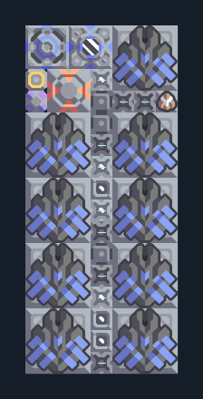

# Fuse 9 กระบอก — ไครโอและโดรนส่งของ

**DEF107** · 06 ป้องกัน · 7×16 ช่อง · **ตรวจผัง**

แนวปืนระยะใกล้สำหรับศัตรูเกราะหนา  
มีน้ำ/ไครโอและ overdrive ในตัว ต้องมียูนิตส่งของที่ logic เลือกได้และกระสุนใน Core; วางหน้าปืนหันทางศัตรู เสริมกำแพงเพื่อรับระยะประชิด  
มี mlog เดิมฝังในแบบ: ห้ามลบ processor หากยังใช้ระบบอัตโนมัติ; ดูวิธีตั้งค่าของผู้สร้างในคู่มือฉบับเต็ม  
  
แหล่ง: Design-It / .wpx.  
ต้นฉบับ: fuse 9 wireless  
MIT; แปลชื่อและคู่มือโดยชุด Serpulo ไทย 2.0  
อ่าน/โครงสร้างผ่านแล้ว ผลทดสอบการทำงานเฉพาะรหัสอยู่ในคู่มือ อัตราจริงขึ้นกับแผนที่และวัตถุดิบ  
  
เป้าหมายป้อม: fuse → พื้นดินและอากาศ; hail → พื้นดิน  
  
หมวด: 06 ป้องกัน • Serpulo ไทย 2.0

**วัสดุก่อสร้าง:** ทองแดง 2232 · กราไฟต์ 2100 · ตะกั่ว 287 · เมตากลาส 68 · พลาสตาเนียม 30 · ซิลิคอน 165 · ทอเรียม 900 · ไทเทเนียม 135

[ดาวน์โหลด .msch](../../schematics/DEF107.msch) · [รหัสนำเข้าจากคลิปบอร์ด](../../codes/DEF107.txt) · [กลับสารบัญ](../INDEX.md)

ภาพประกอบใช้กราฟิกบล็อกจากตัวเกม ไม่ใช่ภาพการรบระหว่างเล่นจริง ทางป้อนต้องจ่ายวัตถุดิบและไฟตามเงื่อนไขที่ระบุ
