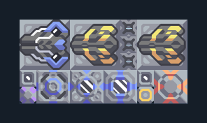

# Cyclone คู่และ Tsunami — แนวขนาดเล็ก

**DEF108** · 06 ป้องกัน · 10×5 ช่อง · **ตรวจผัง**

กระสุนเซิร์จร่วมสถานะเปียกเพื่อต่อสู้  
ต่อไฟ ตรวจน้ำจากพื้น มีไครโอและระบบโดรนส่งกระสุนอัตโนมัติ ต้องมีสินค้าและยูนิตในทีม; เสริมกำแพงและชุดซ่อมตามแนวรบ  
มี mlog เดิมฝังในแบบ: ห้ามลบ processor หากยังใช้ระบบอัตโนมัติ; ดูวิธีตั้งค่าของผู้สร้างในคู่มือฉบับเต็ม  
  
แหล่ง: Design-It / .wpx.  
ต้นฉบับ: Cyclone 2 + Tsunami Wireless  
MIT; แปลชื่อและคู่มือโดยชุด Serpulo ไทย 2.0  
อ่าน/โครงสร้างผ่านแล้ว ผลทดสอบการทำงานเฉพาะรหัสอยู่ในคู่มือ อัตราจริงขึ้นกับแผนที่และวัตถุดิบ  
  
เป้าหมายป้อม: cyclone → พื้นดินและอากาศ; tsunami → พื้นดินและอากาศ  
  
หมวด: 06 ป้องกัน • Serpulo ไทย 2.0

**วัสดุก่อสร้าง:** ทองแดง 540 · กราไฟต์ 38 · ตะกั่ว 669 · เมตากลาส 149 · พลาสตาเนียม 190 · ซิลิคอน 165 · ทอเรียม 100 · ไทเทเนียม 645

[ดาวน์โหลด .msch](../../schematics/DEF108.msch) · [รหัสนำเข้าจากคลิปบอร์ด](../../codes/DEF108.txt) · [กลับสารบัญ](../INDEX.md)

ภาพประกอบใช้กราฟิกบล็อกจากตัวเกม ไม่ใช่ภาพการรบระหว่างเล่นจริง ทางป้อนต้องจ่ายวัตถุดิบและไฟตามเงื่อนไขที่ระบุ
