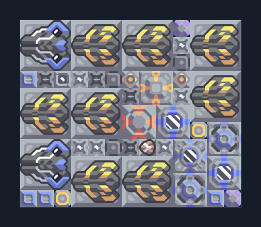

# Cyclone 8 และ Tsunami 2 — แนวขยาย

**DEF109** · 06 ป้องกัน · 13×11 ช่อง · **ตรวจผัง**

แนวกลาง/ท้ายเกมพร้อมของเหลวและกระสุนร่วมกัน  
ต่อไฟ ตรวจน้ำจากพื้น มีไครโอและระบบเติมกระสุนด้วยยูนิตตาม logic; เตรียมสินค้าใน Core และอย่าให้ controller หลายตัวแย่งยูนิตเดียวกัน  
มี mlog เดิมฝังในแบบ: ห้ามลบ processor หากยังใช้ระบบอัตโนมัติ; ดูวิธีตั้งค่าของผู้สร้างในคู่มือฉบับเต็ม  
  
แหล่ง: Design-It / justacommonegg  
ต้นฉบับ: Cyclone Wireless Tsunami 8 (143)  
MIT; แปลชื่อและคู่มือโดยชุด Serpulo ไทย 2.0  
อ่าน/โครงสร้างผ่านแล้ว ผลทดสอบการทำงานเฉพาะรหัสอยู่ในคู่มือ อัตราจริงขึ้นกับแผนที่และวัตถุดิบ  
  
เป้าหมายป้อม: cyclone → พื้นดินและอากาศ; hail → พื้นดิน; tsunami → พื้นดินและอากาศ  
  
หมวด: 06 ป้องกัน • Serpulo ไทย 2.0

**วัสดุก่อสร้าง:** ทองแดง 1917 · กราไฟต์ 105 · ตะกั่ว 1161 · เมตากลาส 420 · ผ้าเฟส 20 · พลาสตาเนียม 670 · ซิลิคอน 303 · ทอเรียม 200 · ไทเทเนียม 1845

[ดาวน์โหลด .msch](../../schematics/DEF109.msch) · [รหัสนำเข้าจากคลิปบอร์ด](../../codes/DEF109.txt) · [กลับสารบัญ](../INDEX.md)

ภาพประกอบใช้กราฟิกบล็อกจากตัวเกม ไม่ใช่ภาพการรบระหว่างเล่นจริง ทางป้อนต้องจ่ายวัตถุดิบและไฟตามเงื่อนไขที่ระบุ
