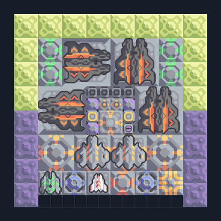

# ฐาน Spectre — กำแพง โล่ ซ่อมและส่งไกล

**DEF110** · 06 ป้องกัน · 16×16 ช่อง · **ตรวจผัง**

ฐานป้องกันท้ายเกมที่ประกอบระบบครบ  
ต่อ Mass Driver จากฐานกระสุนเข้าคลังและเชื่อมไฟ มีโล่/ซ่อม/กำแพง/น้ำและระบบโดรนส่งผ้าเฟส; ตรวจข้อความผู้สร้างและสวิตช์ override ก่อนใช้  
มี mlog เดิมฝังในแบบ: ห้ามลบ processor หากยังใช้ระบบอัตโนมัติ; ดูวิธีตั้งค่าของผู้สร้างในคู่มือฉบับเต็ม  
  
แหล่ง: Design-It / y0.  
ต้นฉบับ: Spectre Outpost v1.2.0  
MIT; แปลชื่อและคู่มือโดยชุด Serpulo ไทย 2.0  
อ่าน/โครงสร้างผ่านแล้ว ผลทดสอบการทำงานเฉพาะรหัสอยู่ในคู่มือ อัตราจริงขึ้นกับแผนที่และวัตถุดิบ  
  
เป้าหมายป้อม: spectre → พื้นดินและอากาศ  
  
หมวด: 06 ป้องกัน • Serpulo ไทย 2.0

**วัสดุก่อสร้าง:** ทองแดง 4155 · กราไฟต์ 1265 · ตะกั่ว 1190 · เมตากลาส 172 · ผ้าเฟส 40 · พลาสตาเนียม 1070 · ซิลิคอน 1080 · เซิร์จอัลลอย 1015 · ทอเรียม 1452 · ไทเทเนียม 772

[ดาวน์โหลด .msch](../../schematics/DEF110.msch) · [รหัสนำเข้าจากคลิปบอร์ด](../../codes/DEF110.txt) · [กลับสารบัญ](../INDEX.md)

ภาพประกอบใช้กราฟิกบล็อกจากตัวเกม ไม่ใช่ภาพการรบระหว่างเล่นจริง ทางป้อนต้องจ่ายวัตถุดิบและไฟตามเงื่อนไขที่ระบุ
