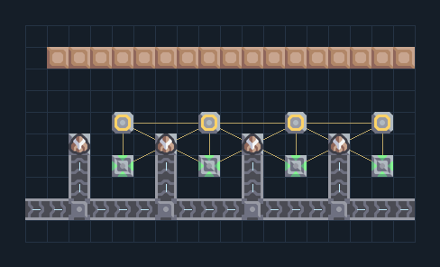

# Hail 4 — สายกราไฟต์และซ่อม

**DEF205** · 06 ป้องกัน · 18×10 ช่อง · **ตรวจผัง**

แนว 4 ป้อมปืนร่วมสายป้อนและซ่อม  
ด้านบนหันหาแนวศัตรู ต่อกระสุนชนิดเดียวที่ระบุและไฟให้ชุดซ่อม/ปืน; น้ำหรือไครโอช่วยหล่อเย็นเมื่อมีพอร์ต; อย่ารวมของหลายชนิดในสายกระสุน  
  
จุดต่อก่อนหมุน (0,0 มุมซ้ายล่าง):  
กระสุน graphite @ 0,1  
ไฟเข้าชุดปืนและซ่อม @ 4,5  
Serpulo • ไทย 2.0 • บล็อกเดิม • สร้างใหม่  
สถานะ: โครงสร้าง; ยังไม่ยืนยันการต่อสู้/กำลังผลิตจริง  
  
เป้าหมายป้อม: hail → พื้นดิน  
  
หมวด: 06 ป้องกัน • Serpulo ไทย 2.0

**วัสดุก่อสร้าง:** ทองแดง 404 · กราไฟต์ 68 · ตะกั่ว 144

[ดาวน์โหลด .msch](../../schematics/DEF205.msch) · [รหัสนำเข้าจากคลิปบอร์ด](../../codes/DEF205.txt) · [กลับสารบัญ](../INDEX.md)

ภาพประกอบใช้กราฟิกบล็อกจากตัวเกม ไม่ใช่ภาพการรบระหว่างเล่นจริง ทางป้อนต้องจ่ายวัตถุดิบและไฟตามเงื่อนไขที่ระบุ
