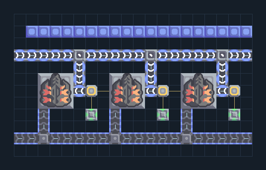

# Ripple 3 — กระสุนระเบิด น้ำและซ่อม

**DEF206** · 06 ป้องกัน · 20×12 ช่อง · **ทดสอบการป้อน**

แนว 3 ป้อมปืนร่วมสายป้อนและซ่อม  
ด้านบนหันหาแนวศัตรู ต่อกระสุนชนิดเดียวที่ระบุและไฟให้ชุดซ่อม/ปืน; น้ำหรือไครโอช่วยหล่อเย็นเมื่อมีพอร์ต; อย่ารวมของหลายชนิดในสายกระสุน  
  
จุดต่อก่อนหมุน (0,0 มุมซ้ายล่าง):  
กระสุน blast-compound @ 0,1  
หล่อเย็น water @ 0,8  
ไฟเข้าชุดปืนและซ่อม @ 6,5  
Serpulo • ไทย 2.0 • บล็อกเดิม • สร้างใหม่  
  
ผลทดสอบ Build 160.7: น้ำ/กระสุนที่ระบุเข้าถึงทุกป้อม และชุดซ่อมได้รับไฟจากจุดต่อในผัง; ทดสอบ 300 วินาที ยังไม่ได้วัดการยิง ความเสียหาย หรือการรับเวฟ  
  
เป้าหมายป้อม: ripple → พื้นดิน  
  
หมวด: 06 ป้องกัน • Serpulo ไทย 2.0

**วัสดุก่อสร้าง:** ทองแดง 563 · กราไฟต์ 417 · ตะกั่ว 131 · เมตากลาส 32 · ไทเทเนียม 369

[ดาวน์โหลด .msch](../../schematics/DEF206.msch) · [รหัสนำเข้าจากคลิปบอร์ด](../../codes/DEF206.txt) · [กลับสารบัญ](../INDEX.md)

ภาพประกอบใช้กราฟิกบล็อกจากตัวเกม ไม่ใช่ภาพการรบระหว่างเล่นจริง ทางป้อนต้องจ่ายวัตถุดิบและไฟตามเงื่อนไขที่ระบุ
