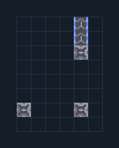

# สะพานเลี้ยวมุม 1 สาย — ตั้ง link ครบ

**LOG101** · 05 ขนส่งและคลัง · 6×8 ช่อง · **ทดสอบระบบ**

ขนสินค้าเข้าแนวซ้ายแล้วเลี้ยวขึ้นด้านบน  
ป้อนสินค้าเข้าฝั่งซ้ายล่างและต่อสายออกด้านบน bridge links ภายในตั้งไว้แล้ว แต่ละสะพานอยู่ในระยะปกติ ไม่ใช้ processor  
  
จุดต่อก่อนหมุน (0,0 มุมซ้ายล่าง):  
ป้อนของจากด้านซ้าย @ 0,1  
ของออกด้านบน @ 4,7  
Serpulo • ไทย 2.0 • บล็อกเดิม • สร้างใหม่  
  
ผลทดสอบ Build 160.7: ขนส่งทองแดง 631 ชิ้น และตะกั่ว 0 ชิ้นใน 60 วินาที; ของปะปน 0 ชิ้น  
  
หมวด: 05 ขนส่งและคลัง • Serpulo ไทย 2.0

**วัสดุก่อสร้าง:** ทองแดง 20 · ตะกั่ว 20 · ไทเทเนียม 2

[ดาวน์โหลด .msch](../../schematics/LOG101.msch) · [รหัสนำเข้าจากคลิปบอร์ด](../../codes/LOG101.txt) · [กลับสารบัญ](../INDEX.md)

ภาพประกอบใช้กราฟิกบล็อกจากตัวเกม ไม่ใช่ภาพการรบระหว่างเล่นจริง ทางป้อนต้องจ่ายวัตถุดิบและไฟตามเงื่อนไขที่ระบุ
