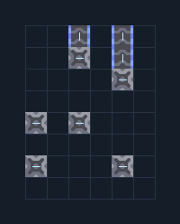

# สะพานเลี้ยวมุม 2 สาย — แยกวัตถุดิบ

**LOG102** · 05 ขนส่งและคลัง · 6×8 ช่อง · **ทดสอบระบบ**

ขนสองวัตถุดิบผ่านมุมโดยแยกเส้นทาง  
ป้อนวัตถุดิบคนละสายทางซ้าย ต่อโรงงานคนละสายด้านบน ห้ามต่อสายออกเข้าด้วยกันถ้าโรงงานต้องแยกวัตถุดิบ  
  
จุดต่อก่อนหมุน (0,0 มุมซ้ายล่าง):  
วัตถุดิบ A เข้าซ้าย @ 0,1  
วัตถุดิบ B เข้าซ้าย @ 0,3  
A ออกบน @ 4,7  
B ออกบน @ 2,7  
Serpulo • ไทย 2.0 • บล็อกเดิม • สร้างใหม่  
  
ผลทดสอบ Build 160.7: ขนส่งทองแดง 631 ชิ้น และตะกั่ว 634 ชิ้นใน 60 วินาที; ของปะปน 0 ชิ้น  
  
หมวด: 05 ขนส่งและคลัง • Serpulo ไทย 2.0

**วัสดุก่อสร้าง:** ทองแดง 39 · ตะกั่ว 39 · ไทเทเนียม 3

[ดาวน์โหลด .msch](../../schematics/LOG102.msch) · [รหัสนำเข้าจากคลิปบอร์ด](../../codes/LOG102.txt) · [กลับสารบัญ](../INDEX.md)

ภาพประกอบใช้กราฟิกบล็อกจากตัวเกม ไม่ใช่ภาพการรบระหว่างเล่นจริง ทางป้อนต้องจ่ายวัตถุดิบและไฟตามเงื่อนไขที่ระบุ
