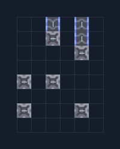

# สะพานเลี้ยวมุมสวนทาง — ไปและกลับ

**LOG103** · 05 ขนส่งและคลัง · 6×8 ช่อง · **ทดสอบระบบ**

เดินสายส่งเข้าและส่งกลับคนละทิศผ่านมุมเดียว  
ขาไปป้อนซ้ายล่างออกบนขวา ขากลับป้อนบนซ้ายออกฝั่งซ้าย ปลาย output bridge ซ้ายต้องต่อสายพานหันออกเพิ่มหลังวาง ห้ามเชื่อมกลับเข้าเส้นทางขาไป  
  
จุดต่อก่อนหมุน (0,0 มุมซ้ายล่าง):  
ขาไปเข้าซ้าย @ 0,1  
ขาไปออกบนขวา @ 4,7  
ขากลับเข้าบนซ้าย @ 2,7  
ขากลับออกซ้าย ต่อสายพานออกนอกแบบ @ 0,3  
Serpulo • ไทย 2.0 • บล็อกเดิม • สร้างใหม่  
  
ผลทดสอบ Build 160.7: ขนส่งทองแดง 631 ชิ้น และตะกั่ว 633 ชิ้นใน 60 วินาที; ของปะปน 0 ชิ้น  
  
หมวด: 05 ขนส่งและคลัง • Serpulo ไทย 2.0

**วัสดุก่อสร้าง:** ทองแดง 39 · ตะกั่ว 39 · ไทเทเนียม 3

[ดาวน์โหลด .msch](../../schematics/LOG103.msch) · [รหัสนำเข้าจากคลิปบอร์ด](../../codes/LOG103.txt) · [กลับสารบัญ](../INDEX.md)

ภาพประกอบใช้กราฟิกบล็อกจากตัวเกม ไม่ใช่ภาพการรบระหว่างเล่นจริง ทางป้อนต้องจ่ายวัตถุดิบและไฟตามเงื่อนไขที่ระบุ
