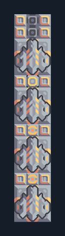

# รับ Mass Driver 4 ตัวเข้าคลัง

**LOG104** · 05 ขนส่งและคลัง · 3×17 ช่อง · **ตรวจผัง**

รวมการส่งไกลหลายจุดกลับ Core  
วางด้านปลายส่ง Phase Conveyor ชิด Core/คลัง เลือก Mass Driver ต้นทางให้ส่งมาฝั่งนี้ มีเครื่องรับ 4 ตัวและไฟ; อย่าเปลี่ยน phase links ภายใน  
  
แหล่ง: Design-It / y0.  
ต้นฉบับ: - CoreMD Receiver 4x60  
MIT; แปลชื่อและคู่มือโดยชุด Serpulo ไทย 2.0  
อ่าน/โครงสร้างผ่านแล้ว ผลทดสอบการทำงานเฉพาะรหัสอยู่ในคู่มือ อัตราจริงขึ้นกับแผนที่และวัตถุดิบ  
  
หมวด: 05 ขนส่งและคลัง • Serpulo ไทย 2.0

**วัสดุก่อสร้าง:** ทองแดง 20 · กราไฟต์ 100 · ตะกั่ว 650 · ผ้าเฟส 50 · ซิลิคอน 370 · ทอเรียม 200 · ไทเทเนียม 500

[ดาวน์โหลด .msch](../../schematics/LOG104.msch) · [รหัสนำเข้าจากคลิปบอร์ด](../../codes/LOG104.txt) · [กลับสารบัญ](../INDEX.md)

ภาพประกอบใช้กราฟิกบล็อกจากตัวเกม ไม่ใช่ภาพการรบระหว่างเล่นจริง ทางป้อนต้องจ่ายวัตถุดิบและไฟตามเงื่อนไขที่ระบุ
