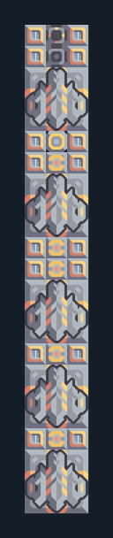

# รับ Mass Driver 5 ตัวเข้าคลัง

**LOG105** · 05 ขนส่งและคลัง · 3×23 ช่อง · **ตรวจผัง**

รวมเหมืองขนาดใหญ่กลับ Core  
วางปลาย Phase Conveyor ชิด Core/คลัง ต่อไฟ ให้เครื่องส่งเลือกเครื่องรับที่ทีมเดียวกันในระยะ; ผังนี้เป็นฝั่งรับและไม่มีเหมืองในตัว  
  
แหล่ง: Design-It / y0.  
ต้นฉบับ: - CoreMD Receiver 5x60  
MIT; แปลชื่อและคู่มือโดยชุด Serpulo ไทย 2.0  
อ่าน/โครงสร้างผ่านแล้ว ผลทดสอบการทำงานเฉพาะรหัสอยู่ในคู่มือ อัตราจริงขึ้นกับแผนที่และวัตถุดิบ  
  
หมวด: 05 ขนส่งและคลัง • Serpulo ไทย 2.0

**วัสดุก่อสร้าง:** ทองแดง 33 · กราไฟต์ 160 · ตะกั่ว 895 · ผ้าเฟส 80 · ซิลิคอน 487 · ทอเรียม 250 · ไทเทเนียม 625

[ดาวน์โหลด .msch](../../schematics/LOG105.msch) · [รหัสนำเข้าจากคลิปบอร์ด](../../codes/LOG105.txt) · [กลับสารบัญ](../INDEX.md)

ภาพประกอบใช้กราฟิกบล็อกจากตัวเกม ไม่ใช่ภาพการรบระหว่างเล่นจริง ทางป้อนต้องจ่ายวัตถุดิบและไฟตามเงื่อนไขที่ระบุ
