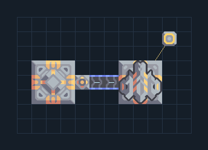

# Mass Driver — ฝั่งส่งพร้อมคลัง

**LOG201** · 05 ขนส่งและคลัง · 12×8 ช่อง · **ตรวจผัง**

ส่งทรัพยากรข้ามภูมิประเทศจากคลัง  
ป้อนสินค้าเข้า Vault ด้านซ้าย เลือก Mass Driver แล้วแตะเครื่องรับทีมเดียวกันที่อยู่ในระยะ; ต่อไฟทั้งสองฝั่ง ใส่สินค้าเดียวหรือแยกหลังรับ  
  
จุดต่อก่อนหมุน (0,0 มุมซ้ายล่าง):  
สินค้าเข้า Vault ด้านซ้าย @ 1,3  
ไฟเครื่องส่ง @ 10,6  
Serpulo • ไทย 2.0 • บล็อกเดิม • สร้างใหม่  
สถานะ: โครงสร้าง; ยังไม่ยืนยันการต่อสู้/กำลังผลิตจริง  
  
หมวด: 05 ขนส่งและคลัง • Serpulo ไทย 2.0

**วัสดุก่อสร้าง:** ทองแดง 4 · ตะกั่ว 133 · ซิลิคอน 105 · ทอเรียม 175 · ไทเทเนียม 402

[ดาวน์โหลด .msch](../../schematics/LOG201.msch) · [รหัสนำเข้าจากคลิปบอร์ด](../../codes/LOG201.txt) · [กลับสารบัญ](../INDEX.md)

ภาพประกอบใช้กราฟิกบล็อกจากตัวเกม ไม่ใช่ภาพการรบระหว่างเล่นจริง ทางป้อนต้องจ่ายวัตถุดิบและไฟตามเงื่อนไขที่ระบุ
