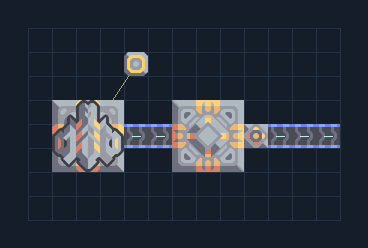

# Mass Driver — ฝั่งรับพร้อมคลัง

**LOG202** · 05 ขนส่งและคลัง · 13×8 ช่อง · **ตรวจผัง**

รับทรัพยากรไกลและกระจายผ่านคลัง  
เลือกเครื่องส่งให้ link มาที่ Mass Driver นี้ ต่อไฟและต่อสายออกจาก Unloader ด้านขวา; เลือก item บน Unloader เพื่อแยกสินค้าที่ต้องการ  
  
จุดต่อก่อนหมุน (0,0 มุมซ้ายล่าง):  
สินค้าออกจากคลัง @ 12,3  
ไฟเครื่องรับ @ 4,6  
Serpulo • ไทย 2.0 • บล็อกเดิม • สร้างใหม่  
สถานะ: โครงสร้าง; ยังไม่ยืนยันการต่อสู้/กำลังผลิตจริง  
  
หมวด: 05 ขนส่งและคลัง • Serpulo ไทย 2.0

**วัสดุก่อสร้าง:** ทองแดง 7 · ตะกั่ว 136 · ซิลิคอน 105 · ทอเรียม 175 · ไทเทเนียม 405

[ดาวน์โหลด .msch](../../schematics/LOG202.msch) · [รหัสนำเข้าจากคลิปบอร์ด](../../codes/LOG202.txt) · [กลับสารบัญ](../INDEX.md)

ภาพประกอบใช้กราฟิกบล็อกจากตัวเกม ไม่ใช่ภาพการรบระหว่างเล่นจริง ทางป้อนต้องจ่ายวัตถุดิบและไฟตามเงื่อนไขที่ระบุ
