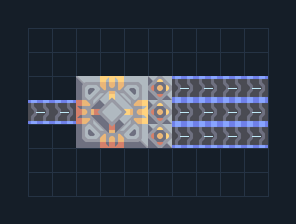

# คลังพักสินค้า — แยก 3 สายออก

**LOG203** · 05 ขนส่งและคลัง · 10×7 ช่อง · **ตรวจผัง**

พักสินค้าและเลือกวัตถุดิบให้สามโรงงาน  
ป้อนสินค้าด้านซ้าย เลือกชนิดบน Unloader ทั้งสามตัวก่อนต่อโรงงานด้านขวา ไม่เลือกชนิดจะออกของผสมตามสินค้าที่มี  
  
จุดต่อก่อนหมุน (0,0 มุมซ้ายล่าง):  
สินค้าเข้าคลัง @ 0,3  
เลือกสินค้าบน Unloader แล้วต่อสายนี้ @ 9,2  
เลือกสินค้าบน Unloader แล้วต่อสายนี้ @ 9,3  
เลือกสินค้าบน Unloader แล้วต่อสายนี้ @ 9,4  
Serpulo • ไทย 2.0 • บล็อกเดิม • สร้างใหม่  
สถานะ: โครงสร้าง; ยังไม่ยืนยันการต่อสู้/กำลังผลิตจริง  
  
หมวด: 05 ขนส่งและคลัง • Serpulo ไทย 2.0

**วัสดุก่อสร้าง:** ทองแดง 14 · ตะกั่ว 14 · ซิลิคอน 90 · ทอเรียม 125 · ไทเทเนียม 339

[ดาวน์โหลด .msch](../../schematics/LOG203.msch) · [รหัสนำเข้าจากคลิปบอร์ด](../../codes/LOG203.txt) · [กลับสารบัญ](../INDEX.md)

ภาพประกอบใช้กราฟิกบล็อกจากตัวเกม ไม่ใช่ภาพการรบระหว่างเล่นจริง ทางป้อนต้องจ่ายวัตถุดิบและไฟตามเงื่อนไขที่ระบุ
