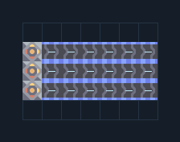

# ต่อ Core — แยกวัสดุโรงงาน 3 ชนิด

**LOG204** · 05 ขนส่งและคลัง · 7×5 ช่อง · **ตรวจผัง**

ป้อนวัสดุสามชนิดจากขอบ Core/คลัง  
วาง Unloader ทางซ้ายชิดขอบ Core/คลัง เลือกชนิดบนแต่ละตัวแล้วต่อสายออก ห้ามปล่อยค่าว่างเมื่อโรงงานรับสายแยก  
  
จุดต่อก่อนหมุน (0,0 มุมซ้ายล่าง):  
ชิด Core/คลังและเลือกชนิด @ 0,1  
สายสินค้าที่เลือก @ 6,1  
ชิด Core/คลังและเลือกชนิด @ 0,2  
สายสินค้าที่เลือก @ 6,2  
ชิด Core/คลังและเลือกชนิด @ 0,3  
สายสินค้าที่เลือก @ 6,3  
Serpulo • ไทย 2.0 • บล็อกเดิม • สร้างใหม่  
สถานะ: โครงสร้าง; ยังไม่ยืนยันการต่อสู้/กำลังผลิตจริง  
  
หมวด: 05 ขนส่งและคลัง • Serpulo ไทย 2.0

**วัสดุก่อสร้าง:** ทองแดง 18 · ตะกั่ว 18 · ซิลิคอน 90 · ไทเทเนียม 93

[ดาวน์โหลด .msch](../../schematics/LOG204.msch) · [รหัสนำเข้าจากคลิปบอร์ด](../../codes/LOG204.txt) · [กลับสารบัญ](../INDEX.md)

ภาพประกอบใช้กราฟิกบล็อกจากตัวเกม ไม่ใช่ภาพการรบระหว่างเล่นจริง ทางป้อนต้องจ่ายวัตถุดิบและไฟตามเงื่อนไขที่ระบุ
