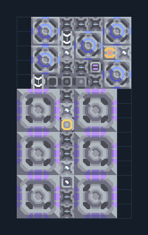

# เหมืองเลเซอร์ 6 หัวพร้อมน้ำ

**MINE101** · 02 เหมืองและปั๊ม · 8×14 ช่อง · **ตรวจผัง**

ขุดแร่กลางเกมพร้อมเพิ่มน้ำ  
วางหัว Laser Drill บนแร่ชนิดเดียวกัน ดูแร่ที่แต่ละหัวเลือก; Water Extractor ต้องอยู่บนพื้นขุดน้ำได้ ต่อผลผลิตกลับ Core และเชื่อมไฟ  
  
แหล่ง: Design-It / y0.  
ต้นฉบับ: Laser Wext 6  
MIT; แปลชื่อและคู่มือโดยชุด Serpulo ไทย 2.0  
อ่าน/โครงสร้างผ่านแล้ว ผลทดสอบการทำงานเฉพาะรหัสอยู่ในคู่มือ อัตราจริงขึ้นกับแผนที่และวัตถุดิบ  
  
หมวด: 02 เหมืองและปั๊ม • Serpulo ไทย 2.0

**วัสดุก่อสร้าง:** ทองแดง 447 · กราไฟต์ 355 · ตะกั่ว 246 · เมตากลาส 186 · ซิลิคอน 180 · ไทเทเนียม 120

[ดาวน์โหลด .msch](../../schematics/MINE101.msch) · [รหัสนำเข้าจากคลิปบอร์ด](../../codes/MINE101.txt) · [กลับสารบัญ](../INDEX.md)

ภาพประกอบใช้กราฟิกบล็อกจากตัวเกม ไม่ใช่ภาพการรบระหว่างเล่นจริง ทางป้อนต้องจ่ายวัตถุดิบและไฟตามเงื่อนไขที่ระบุ
