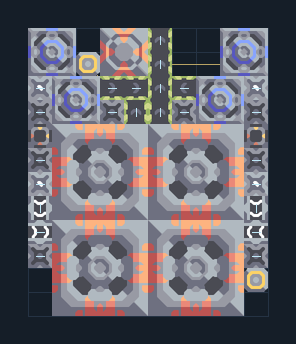

# เหมืองแรงอัด 4 หัว — สายพานพร้อมน้ำ

**MINE102** · 02 เหมืองและปั๊ม · 10×12 ช่อง · **ตรวจผัง**

ขุดแร่ท้ายเกมและส่งออกผ่านสายพาน  
วาง Airblast Drill บนแร่ที่ต้องการ ตรวจอัตราขุดตามจำนวนช่องแร่จริง; น้ำและ overdrive อยู่ในผัง ต่อผลผลิตออกไปฐานและเชื่อมไฟ  
  
แหล่ง: Design-It / justacommonegg  
ต้นฉบับ: AB Wex 04 Belt Custom 1  
MIT; แปลชื่อและคู่มือโดยชุด Serpulo ไทย 2.0  
อ่าน/โครงสร้างผ่านแล้ว ผลทดสอบการทำงานเฉพาะรหัสอยู่ในคู่มือ อัตราจริงขึ้นกับแผนที่และวัตถุดิบ  
  
หมวด: 02 เหมืองและปั๊ม • Serpulo ไทย 2.0

**วัสดุก่อสร้าง:** ทองแดง 436 · กราไฟต์ 144 · ตะกั่ว 284 · เมตากลาส 156 · พลาสตาเนียม 38 · ซิลิคอน 323 · ทอเรียม 300 · ไทเทเนียม 275

[ดาวน์โหลด .msch](../../schematics/MINE102.msch) · [รหัสนำเข้าจากคลิปบอร์ด](../../codes/MINE102.txt) · [กลับสารบัญ](../INDEX.md)

ภาพประกอบใช้กราฟิกบล็อกจากตัวเกม ไม่ใช่ภาพการรบระหว่างเล่นจริง ทางป้อนต้องจ่ายวัตถุดิบและไฟตามเงื่อนไขที่ระบุ
