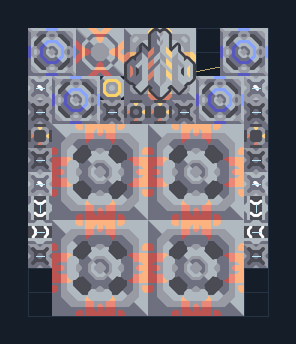

# เหมืองแรงอัด 4 หัว — Mass Driver พร้อมน้ำ

**MINE103** · 02 เหมืองและปั๊ม · 10×12 ช่อง · **ตรวจผัง**

ขุดแร่แล้วส่งข้ามภูมิประเทศ  
วางหัวขุดบนแร่ ต่อไฟและตรวจน้ำจากพื้น จากนั้นเลือก Mass Driver ในแบบแล้วเชื่อมไปเครื่องรับที่ทีมเดียวกันและอยู่ในระยะ  
  
แหล่ง: Design-It / justacommonegg  
ต้นฉบับ: AB Mdo Wex 04 Custom 1  
MIT; แปลชื่อและคู่มือโดยชุด Serpulo ไทย 2.0  
อ่าน/โครงสร้างผ่านแล้ว ผลทดสอบการทำงานเฉพาะรหัสอยู่ในคู่มือ อัตราจริงขึ้นกับแผนที่และวัตถุดิบ  
  
หมวด: 02 เหมืองและปั๊ม • Serpulo ไทย 2.0

**วัสดุก่อสร้าง:** ทองแดง 440 · กราไฟต์ 136 · ตะกั่ว 407 · เมตากลาส 156 · พลาสตาเนียม 30 · ซิลิคอน 390 · ทอเรียม 350 · ไทเทเนียม 400

[ดาวน์โหลด .msch](../../schematics/MINE103.msch) · [รหัสนำเข้าจากคลิปบอร์ด](../../codes/MINE103.txt) · [กลับสารบัญ](../INDEX.md)

ภาพประกอบใช้กราฟิกบล็อกจากตัวเกม ไม่ใช่ภาพการรบระหว่างเล่นจริง ทางป้อนต้องจ่ายวัตถุดิบและไฟตามเงื่อนไขที่ระบุ
