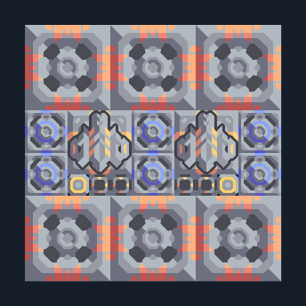

# เหมืองแรงอัด 6 หัว — ส่งไกลแบบแน่น

**MINE104** · 02 เหมืองและปั๊ม · 12×12 ช่อง · **ตรวจผัง**

เหมืองขนาดกลางพร้อมเครื่องส่งสองตัว  
แร่ชนิดเดียวกันใต้หัวขุด น้ำจากพื้น ต่อไฟ ตั้งปลายทางของ Mass Driver ทั้งสองตัวไปฝั่งรับ การตั้ง link ไปนอกแบบทำหลังวาง  
  
แหล่ง: Design-It / justacommonegg  
ต้นฉบับ: AB Mdo Wex 06 Compact  
MIT; แปลชื่อและคู่มือโดยชุด Serpulo ไทย 2.0  
อ่าน/โครงสร้างผ่านแล้ว ผลทดสอบการทำงานเฉพาะรหัสอยู่ในคู่มือ อัตราจริงขึ้นกับแผนที่และวัตถุดิบ  
  
หมวด: 02 เหมืองและปั๊ม • Serpulo ไทย 2.0

**วัสดุก่อสร้าง:** ทองแดง 582 · กราไฟต์ 180 · ตะกั่ว 450 · เมตากลาส 180 · ซิลิคอน 510 · ทอเรียม 550 · ไทเทเนียม 550

[ดาวน์โหลด .msch](../../schematics/MINE104.msch) · [รหัสนำเข้าจากคลิปบอร์ด](../../codes/MINE104.txt) · [กลับสารบัญ](../INDEX.md)

ภาพประกอบใช้กราฟิกบล็อกจากตัวเกม ไม่ใช่ภาพการรบระหว่างเล่นจริง ทางป้อนต้องจ่ายวัตถุดิบและไฟตามเงื่อนไขที่ระบุ
