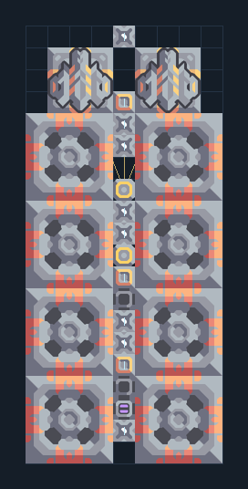

# เหมืองแรงอัด 8 หัว — รับน้ำภายนอก

**MINE105** · 02 เหมืองและปั๊ม · 9×20 ช่อง · **ตรวจผัง**

เหมืองสำหรับพื้นที่ที่ขุดน้ำในตัวไม่ได้  
วางหัวขุดทับแร่ ต่อไฟและน้ำจากฐานเข้าท่อภายนอก มี Mass Driver สองตัว ต้องเลือกเครื่องรับหลังวางและไม่รวมสายผลผลิตจนตัน  
  
แหล่ง: Design-It / y0.  
ต้นฉบับ: Airblast Extw 8  
MIT; แปลชื่อและคู่มือโดยชุด Serpulo ไทย 2.0  
อ่าน/โครงสร้างผ่านแล้ว ผลทดสอบการทำงานเฉพาะรหัสอยู่ในคู่มือ อัตราจริงขึ้นกับแผนที่และวัตถุดิบ  
  
หมวด: 02 เหมืองและปั๊ม • Serpulo ไทย 2.0

**วัสดุก่อสร้าง:** ทองแดง 533 · กราไฟต์ 67 · ตะกั่ว 296 · เมตากลาส 64 · ผ้าเฟส 15 · ซิลิคอน 651 · ทอเรียม 700 · ไทเทเนียม 650

[ดาวน์โหลด .msch](../../schematics/MINE105.msch) · [รหัสนำเข้าจากคลิปบอร์ด](../../codes/MINE105.txt) · [กลับสารบัญ](../INDEX.md)

ภาพประกอบใช้กราฟิกบล็อกจากตัวเกม ไม่ใช่ภาพการรบระหว่างเล่นจริง ทางป้อนต้องจ่ายวัตถุดิบและไฟตามเงื่อนไขที่ระบุ
