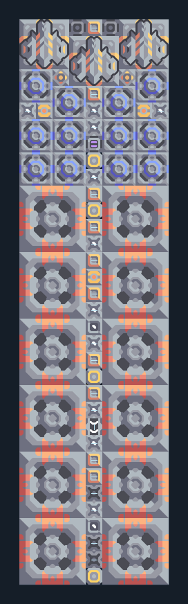

# เหมืองแรงอัด 12 หัว — น้ำในตัว

**MINE106** · 02 เหมืองและปั๊ม · 9×34 ช่อง · **ตรวจผัง**

เหมืองแถวยาวพร้อมน้ำและส่งไกล  
ใช้พื้นที่แร่ยาวและพื้นขุดน้ำได้ ต่อไฟ ตั้งปลายทางเครื่องส่งทั้งสามตัว ตรวจว่าแต่ละหัวขุดเลือกแร่เดียวกันก่อนใช้จริง  
  
แหล่ง: Design-It / justacommonegg  
ต้นฉบับ: AB Mdo Wex 12  
MIT; แปลชื่อและคู่มือโดยชุด Serpulo ไทย 2.0  
อ่าน/โครงสร้างผ่านแล้ว ผลทดสอบการทำงานเฉพาะรหัสอยู่ในคู่มือ อัตราจริงขึ้นกับแผนที่และวัตถุดิบ  
  
หมวด: 02 เหมืองและปั๊ม • Serpulo ไทย 2.0

**วัสดุก่อสร้าง:** ทองแดง 1194 · กราไฟต์ 517 · ตะกั่ว 941 · เมตากลาส 453 · ผ้าเฟส 50 · ซิลิคอน 1075 · ทอเรียม 1050 · ไทเทเนียม 1025

[ดาวน์โหลด .msch](../../schematics/MINE106.msch) · [รหัสนำเข้าจากคลิปบอร์ด](../../codes/MINE106.txt) · [กลับสารบัญ](../INDEX.md)

ภาพประกอบใช้กราฟิกบล็อกจากตัวเกม ไม่ใช่ภาพการรบระหว่างเล่นจริง ทางป้อนต้องจ่ายวัตถุดิบและไฟตามเงื่อนไขที่ระบุ
