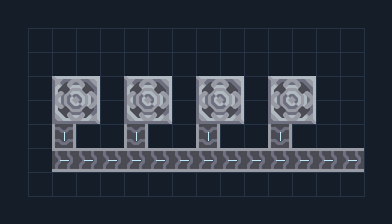

# เหมืองลม 4 หัว — ผลผลิตรวม

**MINE202** · 02 เหมืองและปั๊ม · 14×7 ช่อง · **ตรวจผัง**

รวมผลผลิตจาก 4 หัวขุดไว้ทางออกเดียว  
วางตัวหัวขุดทับแร่ชนิดเดียวกัน ดูแร่ที่แต่ละหัวเลือก ผลผลิตขึ้นกับจำนวนช่องแร่และความแข็ง; ทรายต้องใช้หัวขุดที่ตรงแร่; สายออกนี้เหมาะการขุดต้นเกม  
  
จุดต่อก่อนหมุน (0,0 มุมซ้ายล่าง):  
แร่รวมไป Core; สายพานหันขวา @ 13,1  
Serpulo • ไทย 2.0 • บล็อกเดิม • สร้างใหม่  
สถานะ: โครงสร้าง; ยังไม่ยืนยันการต่อสู้/กำลังผลิตจริง  
  
หมวด: 02 เหมืองและปั๊ม • Serpulo ไทย 2.0

**วัสดุก่อสร้าง:** ทองแดง 89 · กราไฟต์ 40

[ดาวน์โหลด .msch](../../schematics/MINE202.msch) · [รหัสนำเข้าจากคลิปบอร์ด](../../codes/MINE202.txt) · [กลับสารบัญ](../INDEX.md)

ภาพประกอบใช้กราฟิกบล็อกจากตัวเกม ไม่ใช่ภาพการรบระหว่างเล่นจริง ทางป้อนต้องจ่ายวัตถุดิบและไฟตามเงื่อนไขที่ระบุ
