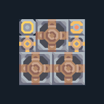

# ไฟเริ่มต้น — ถ่านหิน 2 เครื่อง

**POWER101** · 04 ไฟฟ้า · 4×4 ช่อง · **ทดสอบระบบ**

เริ่มจากแร่ถ่านหินโดยไม่ต้องใช้ไฟก่อน  
วางหัวขุดทั้งสามบนถ่านหิน ต่อเสาไฟเข้าฐาน รอถ่านหินไหลเข้าเครื่อง  
  
แหล่ง: Design-It / wpx  
ต้นฉบับ: Combustion 02x on Coal  
MIT; แปลชื่อและคู่มือโดยชุด Serpulo ไทย 2.0  
อ่าน/โครงสร้างผ่านแล้ว ผลทดสอบการทำงานเฉพาะรหัสอยู่ในคู่มือ อัตราจริงขึ้นกับแผนที่และวัตถุดิบ  
  
ผลทดสอบ Build 160.7: ผลิตไฟรวมเฉลี่ย 120/วินาทีในการทดสอบ 300 วินาที; เหลือหลังโหลดภายในประมาณ 120/วินาที  
  
หมวด: 04 ไฟฟ้า • Serpulo ไทย 2.0

**วัสดุก่อสร้าง:** ทองแดง 93 · ตะกั่ว 56

[ดาวน์โหลด .msch](../../schematics/POWER101.msch) · [รหัสนำเข้าจากคลิปบอร์ด](../../codes/POWER101.txt) · [กลับสารบัญ](../INDEX.md)

ภาพประกอบใช้กราฟิกบล็อกจากตัวเกม ไม่ใช่ภาพการรบระหว่างเล่นจริง ทางป้อนต้องจ่ายวัตถุดิบและไฟตามเงื่อนไขที่ระบุ
