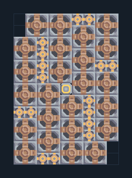

# ไฟถ่านหิน — เหมือง 16 เครื่องต่อซ้ำ

**POWER102** · 04 ไฟฟ้า · 9×13 ช่อง · **ตรวจผัง**

ขยายไฟเริ่มต้นบนแร่ถ่านหิน  
วางหัวขุดบนถ่านหิน ผังมีหัวขุด 24 และเครื่องไฟ 16; ต่อเสาเข้าฐาน รอระบบกระจายของก่อนเพิ่มโหลด; ต่อซ้ำตามภาพคู่มือ  
  
แหล่ง: Design-It / justacommonegg  
ต้นฉบับ: combustion on coal (113)  
MIT; แปลชื่อและคู่มือโดยชุด Serpulo ไทย 2.0  
อ่าน/โครงสร้างผ่านแล้ว ผลทดสอบการทำงานเฉพาะรหัสอยู่ในคู่มือ อัตราจริงขึ้นกับแผนที่และวัตถุดิบ  
  
หมวด: 04 ไฟฟ้า • Serpulo ไทย 2.0

**วัสดุก่อสร้าง:** ทองแดง 690 · ตะกั่ว 246

[ดาวน์โหลด .msch](../../schematics/POWER102.msch) · [รหัสนำเข้าจากคลิปบอร์ด](../../codes/POWER102.txt) · [กลับสารบัญ](../INDEX.md)

ภาพประกอบใช้กราฟิกบล็อกจากตัวเกม ไม่ใช่ภาพการรบระหว่างเล่นจริง ทางป้อนต้องจ่ายวัตถุดิบและไฟตามเงื่อนไขที่ระบุ
