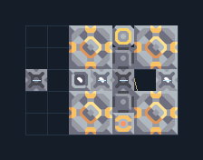

# ไอน้ำ — ถ่านหินและน้ำภายนอก 4 เครื่อง

**POWER103** · 04 ไฟฟ้า · 7×5 ช่อง · **ตรวจผัง**

ไฟกลางเกมแบบแถวเล็กต่อขยาย  
ต่อถ่านหินเข้าทางสายพานและน้ำเข้าท่อ ใช้แหล่งไฟเล็กเริ่มปั๊มก่อน เชื่อมเสาเข้าฐานเมื่อเครื่องมีเชื้อเพลิงและน้ำ  
  
แหล่ง: Design-It / justacommonegg  
ต้นฉบับ: Steam C ExtW 04x Stackable  
MIT; แปลชื่อและคู่มือโดยชุด Serpulo ไทย 2.0  
อ่าน/โครงสร้างผ่านแล้ว ผลทดสอบการทำงานเฉพาะรหัสอยู่ในคู่มือ อัตราจริงขึ้นกับแผนที่และวัตถุดิบ  
  
หมวด: 04 ไฟฟ้า • Serpulo ไทย 2.0

**วัสดุก่อสร้าง:** ทองแดง 165 · กราไฟต์ 112 · ตะกั่ว 198 · เมตากลาส 18 · ซิลิคอน 120

[ดาวน์โหลด .msch](../../schematics/POWER103.msch) · [รหัสนำเข้าจากคลิปบอร์ด](../../codes/POWER103.txt) · [กลับสารบัญ](../INDEX.md)

ภาพประกอบใช้กราฟิกบล็อกจากตัวเกม ไม่ใช่ภาพการรบระหว่างเล่นจริง ทางป้อนต้องจ่ายวัตถุดิบและไฟตามเงื่อนไขที่ระบุ
