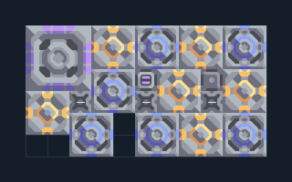

# ไอน้ำ — เหมืองเลเซอร์และขุดน้ำ 6 เครื่อง

**POWER104** · 04 ไฟฟ้า · 11×6 ช่อง · **ทดสอบระบบ**

ไฟจากแร่ถ่านหินพร้อมระบบน้ำในตัว  
วาง Laser Drill บนถ่านหินและ Water Extractor บนพื้นขุดน้ำได้ วางเสาไฟเพิ่มนอกด้านซ้ายแล้ว link ไป Steam Generator (0,1) เพื่อเริ่มเหมือง/น้ำ; รอเครื่องติดก่อนแยกไฟเริ่มต้น เครื่องกำเนิด 6 เครื่องต่อร่วมภายใน  
  
แหล่ง: Design-It / plent  
ต้นฉบับ: Steam Drill 06 (66)  
MIT; แปลชื่อและคู่มือโดยชุด Serpulo ไทย 2.0  
อ่าน/โครงสร้างผ่านแล้ว ผลทดสอบการทำงานเฉพาะรหัสอยู่ในคู่มือ อัตราจริงขึ้นกับแผนที่และวัตถุดิบ  
  
ผลทดสอบ Build 160.7: ผลิตไฟรวมเฉลี่ย 1801/วินาทีในการทดสอบ 300 วินาที; เหลือหลังโหลดภายในประมาณ 1195/วินาที  
  
หมวด: 04 ไฟฟ้า • Serpulo ไทย 2.0

**วัสดุก่อสร้าง:** ทองแดง 451 · กราไฟต์ 365 · ตะกั่ว 438 · เมตากลาส 180 · ซิลิคอน 210 · ไทเทเนียม 20

[ดาวน์โหลด .msch](../../schematics/POWER104.msch) · [รหัสนำเข้าจากคลิปบอร์ด](../../codes/POWER104.txt) · [กลับสารบัญ](../INDEX.md)

ภาพประกอบใช้กราฟิกบล็อกจากตัวเกม ไม่ใช่ภาพการรบระหว่างเล่นจริง ทางป้อนต้องจ่ายวัตถุดิบและไฟตามเงื่อนไขที่ระบุ
