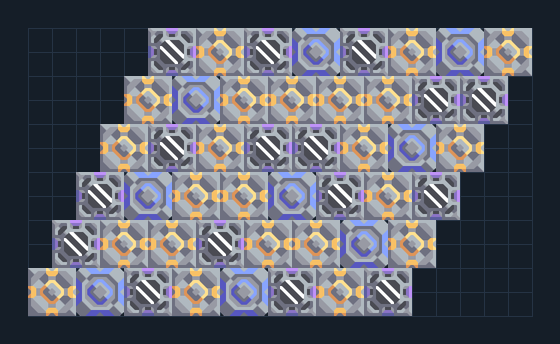

# ไอน้ำ — แถวยาวบนแหล่งน้ำปนเปื้อน

**POWER106** · 04 ไฟฟ้า · 21×12 ช่อง · **ตรวจผัง**

ขยายไฟจากสปอร์บน tainted water  
ผังนี้ออกแบบตามพื้นน้ำปนเปื้อน วางพื้นที่ปั๊มทั้งตัวในน้ำและตรวจประสิทธิภาพ cultivator; จ่ายไฟเริ่มต้นก่อน เพิ่มโหลดเมื่อสปอร์และน้ำเสถียร  
  
แหล่ง: Design-It / anh6844  
ต้นฉบับ: tainted water spore steam  
MIT; แปลชื่อและคู่มือโดยชุด Serpulo ไทย 2.0  
อ่าน/โครงสร้างผ่านแล้ว ผลทดสอบการทำงานเฉพาะรหัสอยู่ในคู่มือ อัตราจริงขึ้นกับแผนที่และวัตถุดิบ  
  
หมวด: 04 ไฟฟ้า • Serpulo ไทย 2.0

**วัสดุก่อสร้าง:** ทองแดง 1835 · กราไฟต์ 575 · ตะกั่ว 1320 · เมตากลาส 450 · ซิลิคอน 1030 · ไทเทเนียม 315

[ดาวน์โหลด .msch](../../schematics/POWER106.msch) · [รหัสนำเข้าจากคลิปบอร์ด](../../codes/POWER106.txt) · [กลับสารบัญ](../INDEX.md)

ภาพประกอบใช้กราฟิกบล็อกจากตัวเกม ไม่ใช่ภาพการรบระหว่างเล่นจริง ทางป้อนต้องจ่ายวัตถุดิบและไฟตามเงื่อนไขที่ระบุ
