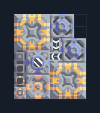

# ดิฟเฟอเรนเชียล — ติด Core 2 เครื่อง

**POWER107** · 04 ไฟฟ้า · 6×7 ช่อง · **ทดสอบระบบ**

ไฟกลางเกมพร้อมไพราไทต์และไครโอ  
ต่อ Unloader (0,0) ชิดขอบ Core ด้านซ้ายของแบบที่มีทราย ถ่านหิน ตะกั่ว ไทเทเนียม; Water Extractor ต้องขุดน้ำได้ วางเสาไฟนอกแบบและ link ไป Cryofluid Mixer (1,2) เพื่อเริ่มระบบก่อนรับโหลด  
  
แหล่ง: Design-It / wpx  
ต้นฉบับ: Diff 2 Core  
MIT; แปลชื่อและคู่มือโดยชุด Serpulo ไทย 2.0  
อ่าน/โครงสร้างผ่านแล้ว ผลทดสอบการทำงานเฉพาะรหัสอยู่ในคู่มือ อัตราจริงขึ้นกับแผนที่และวัตถุดิบ  
  
ผลทดสอบ Build 160.7: ผลิตไฟรวมเฉลี่ย 2035/วินาทีในการทดสอบ 300 วินาที; เหลือหลังโหลดภายในประมาณ 1783/วินาที  
  
หมวด: 04 ไฟฟ้า • Serpulo ไทย 2.0

**วัสดุก่อสร้าง:** ทองแดง 257 · กราไฟต์ 60 · ตะกั่ว 354 · เมตากลาส 162 · ซิลิคอน 200 · ไทเทเนียม 185

[ดาวน์โหลด .msch](../../schematics/POWER107.msch) · [รหัสนำเข้าจากคลิปบอร์ด](../../codes/POWER107.txt) · [กลับสารบัญ](../INDEX.md)

ภาพประกอบใช้กราฟิกบล็อกจากตัวเกม ไม่ใช่ภาพการรบระหว่างเล่นจริง ทางป้อนต้องจ่ายวัตถุดิบและไฟตามเงื่อนไขที่ระบุ
