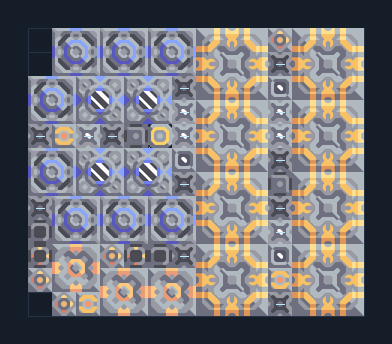

# ดิฟเฟอเรนเชียล — ติดคลัง 8 เครื่อง

**POWER108** · 04 ไฟฟ้า · 14×12 ช่อง · **ตรวจผัง**

ขยายกำลังไฟโดยผลิตเชื้อเพลิงและไครโอร่วมกัน  
เชื่อม Unloader กับ Core/คลังที่มีทราย ถ่านหิน ตะกั่ว ไทเทเนียม; พื้นต้องขุดน้ำได้ มีไฟเริ่มต้น; ผังนี้ไม่มี overdrive ในตัว  
  
แหล่ง: Design-It / tudr  
ต้นฉบับ: diff 8 core no od  
MIT; แปลชื่อและคู่มือโดยชุด Serpulo ไทย 2.0  
อ่าน/โครงสร้างผ่านแล้ว ผลทดสอบการทำงานเฉพาะรหัสอยู่ในคู่มือ อัตราจริงขึ้นกับแผนที่และวัตถุดิบ  
  
หมวด: 04 ไฟฟ้า • Serpulo ไทย 2.0

**วัสดุก่อสร้าง:** ทองแดง 1041 · กราไฟต์ 276 · ตะกั่ว 1509 · เมตากลาส 694 · ซิลิคอน 800 · ไทเทเนียม 740

[ดาวน์โหลด .msch](../../schematics/POWER108.msch) · [รหัสนำเข้าจากคลิปบอร์ด](../../codes/POWER108.txt) · [กลับสารบัญ](../INDEX.md)

ภาพประกอบใช้กราฟิกบล็อกจากตัวเกม ไม่ใช่ภาพการรบระหว่างเล่นจริง ทางป้อนต้องจ่ายวัตถุดิบและไฟตามเงื่อนไขที่ระบุ
