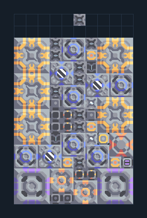

# ดิฟเฟอเรนเชียล — เหมือง 5 เครื่อง

**POWER109** · 04 ไฟฟ้า · 10×16 ช่อง · **ตรวจผัง**

ไฟที่ใช้แร่ในพื้นที่และป้อนไทเทเนียมภายนอก  
วาง Laser Drill ให้ได้ทราย/ถ่านหิน/ตะกั่วตามที่มีในพื้นที่ ป้อนของที่เหมืองไม่ผลิตและไทเทเนียมด้านบน; ดูข้อความต้นฉบับในคู่มือ; ต้องมีไฟเริ่มต้น  
  
แหล่ง: Design-It / artyomic_  
ต้นฉบับ: 5 diff laser drill  
MIT; แปลชื่อและคู่มือโดยชุด Serpulo ไทย 2.0  
อ่าน/โครงสร้างผ่านแล้ว ผลทดสอบการทำงานเฉพาะรหัสอยู่ในคู่มือ อัตราจริงขึ้นกับแผนที่และวัตถุดิบ  
  
หมวด: 04 ไฟฟ้า • Serpulo ไทย 2.0

**วัสดุก่อสร้าง:** ทองแดง 815 · กราไฟต์ 253 · ตะกั่ว 1187 · เมตากลาส 446 · พลาสตาเนียม 30 · ซิลิคอน 580 · ไทเทเนียม 545

[ดาวน์โหลด .msch](../../schematics/POWER109.msch) · [รหัสนำเข้าจากคลิปบอร์ด](../../codes/POWER109.txt) · [กลับสารบัญ](../INDEX.md)

ภาพประกอบใช้กราฟิกบล็อกจากตัวเกม ไม่ใช่ภาพการรบระหว่างเล่นจริง ทางป้อนต้องจ่ายวัตถุดิบและไฟตามเงื่อนไขที่ระบุ
