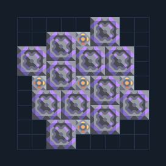

# RTG — 12 เครื่องแบ่งเชื้อเพลิงร่วมกัน

**POWER110** · 04 ไฟฟ้า · 9×9 ช่อง · **ทดสอบระบบ**

ไฟไม่ใช้ของเหลวสำหรับฐานที่มีทอเรียม  
ป้อนทอเรียมด้านซ้ายเข้า RTG ริมแบบที่ (0,5) ระบบ Unloader กระจายเชื้อเพลิงร่วมกัน วางเสาไฟนอกแบบแล้ว link ไปเครื่องนั้นเพื่อส่งไฟเข้าฐาน ใช้เป็นไฟเริ่มต้นระบบใหญ่เมื่อวิจัยครบ  
  
แหล่ง: Design-It / y0.  
ต้นฉบับ: RTG 12x  
MIT; แปลชื่อและคู่มือโดยชุด Serpulo ไทย 2.0  
อ่าน/โครงสร้างผ่านแล้ว ผลทดสอบการทำงานเฉพาะรหัสอยู่ในคู่มือ อัตราจริงขึ้นกับแผนที่และวัตถุดิบ  
  
ผลทดสอบ Build 160.7: ผลิตไฟรวมเฉลี่ย 3240/วินาทีในการทดสอบ 300 วินาที; เหลือหลังโหลดภายในประมาณ 3240/วินาที  
  
หมวด: 04 ไฟฟ้า • Serpulo ไทย 2.0

**วัสดุก่อสร้าง:** ตะกั่ว 1200 · ผ้าเฟส 300 · พลาสตาเนียม 900 · ซิลิคอน 1050 · ทอเรียม 600 · ไทเทเนียม 125

[ดาวน์โหลด .msch](../../schematics/POWER110.msch) · [รหัสนำเข้าจากคลิปบอร์ด](../../codes/POWER110.txt) · [กลับสารบัญ](../INDEX.md)

ภาพประกอบใช้กราฟิกบล็อกจากตัวเกม ไม่ใช่ภาพการรบระหว่างเล่นจริง ทางป้อนต้องจ่ายวัตถุดิบและไฟตามเงื่อนไขที่ระบุ
