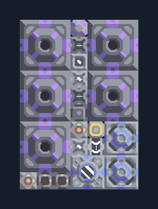

# ทอเรียม — 5 เครื่องพร้อมหล่อเย็น

**POWER111** · 04 ไฟฟ้า · 7×10 ช่อง · **ทดสอบระบบ**

ไฟทอเรียมพร้อมน้ำ ไครโอ และตัวควบคุม  
ต่อ Unloader (0,0) ชิด Core ทางซ้ายที่มีทอเรียมและไทเทเนียม ต่อไฟเริ่มต้นที่เสา (4,3) รอไครโอ/เครื่องติดก่อนแยกไฟเริ่ม; พื้นต้องขุดน้ำได้ คง processor ปิดเครื่องเมื่อไครโอเหลือน้อย  
มี mlog เดิมฝังในแบบ: ห้ามลบ processor หากยังใช้ระบบอัตโนมัติ; ดูวิธีตั้งค่าของผู้สร้างในคู่มือฉบับเต็ม  
  
แหล่ง: Design-It / y0.  
ต้นฉบับ: Thor 05 Core (70)  
MIT; แปลชื่อและคู่มือโดยชุด Serpulo ไทย 2.0  
อ่าน/โครงสร้างผ่านแล้ว ผลทดสอบการทำงานเฉพาะรหัสอยู่ในคู่มือ อัตราจริงขึ้นกับแผนที่และวัตถุดิบ  
  
ผลทดสอบ Build 160.7: ผลิตไฟรวมเฉลี่ย 4500/วินาทีในการทดสอบ 300 วินาที; เหลือหลังโหลดภายในประมาณ 4260/วินาที  
  
หมวด: 04 ไฟฟ้า • Serpulo ไทย 2.0

**วัสดุก่อสร้าง:** ทองแดง 171 · กราไฟต์ 822 · ตะกั่ว 1697 · เมตากลาส 329 · ซิลิคอน 1150 · ทอเรียม 750 · ไทเทเนียม 110

[ดาวน์โหลด .msch](../../schematics/POWER111.msch) · [รหัสนำเข้าจากคลิปบอร์ด](../../codes/POWER111.txt) · [กลับสารบัญ](../INDEX.md)

ภาพประกอบใช้กราฟิกบล็อกจากตัวเกม ไม่ใช่ภาพการรบระหว่างเล่นจริง ทางป้อนต้องจ่ายวัตถุดิบและไฟตามเงื่อนไขที่ระบุ
