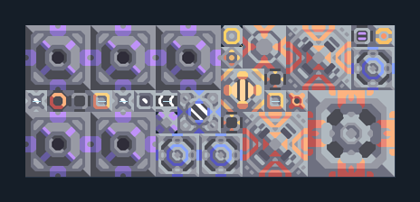

# ทอเรียม — ผลิตจากเศษวัสดุพร้อมระบบหยุด

**POWER112** · 04 ไฟฟ้า · 17×7 ช่อง · **ตรวจผัง**

ไฟทอเรียมจาก Scrap พร้อมแยกแร่และไครโอ  
วาง Airblast Drill บน Scrap จ่ายไฟเริ่มต้นให้แยกแร่และผลิตไครโอ; มี logic คุมเชื้อเพลิง/ไครโอและการเริ่ม; ต้องมีน้ำจากพื้นและพื้นที่ระบายเศษ  
มี mlog เดิมฝังในแบบ: ห้ามลบ processor หากยังใช้ระบบอัตโนมัติ; ดูวิธีตั้งค่าของผู้สร้างในคู่มือฉบับเต็ม  
  
แหล่ง: Design-It / cirrocco  
ต้นฉบับ: CCMD ScrapThor5 AB v4.4  
MIT; แปลชื่อและคู่มือโดยชุด Serpulo ไทย 2.0  
อ่าน/โครงสร้างผ่านแล้ว ผลทดสอบการทำงานเฉพาะรหัสอยู่ในคู่มือ อัตราจริงขึ้นกับแผนที่และวัตถุดิบ  
  
หมวด: 04 ไฟฟ้า • Serpulo ไทย 2.0

**วัสดุก่อสร้าง:** ทองแดง 293 · กราไฟต์ 927 · ตะกั่ว 2027 · เมตากลาส 359 · ผ้าเฟส 10 · พลาสตาเนียม 110 · ซิลิคอน 1699 · ทอเรียม 1060 · ไทเทเนียม 410

[ดาวน์โหลด .msch](../../schematics/POWER112.msch) · [รหัสนำเข้าจากคลิปบอร์ด](../../codes/POWER112.txt) · [กลับสารบัญ](../INDEX.md)

ภาพประกอบใช้กราฟิกบล็อกจากตัวเกม ไม่ใช่ภาพการรบระหว่างเล่นจริง ทางป้อนต้องจ่ายวัตถุดิบและไฟตามเงื่อนไขที่ระบุ
