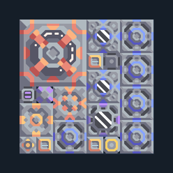

# อิมแพกต์ — 1 เครื่องต่อขอบบน Core พร้อมเชื้อเพลิง

**POWER113** · 04 ไฟฟ้า · 8×8 ช่อง · **ทดสอบระบบ**

ไฟท้ายเกมจากวัตถุดิบใน Core  
Unloader (0,0) ต้องชิดขอบบนของ Core ที่อยู่ด้านล่างแบบ มีทราย ถ่านหิน ตะกั่ว ไทเทเนียม; ไม่วาง Core ชิดซ้าย Pyratite Mixer เพราะเชื้อเพลิงจะย้อนเข้าฐานก่อนใช้ ต่อไฟเริ่มที่เสา (5,0) และรอเครื่องติดก่อนแยกไฟเริ่ม; น้ำ สปอร์ สารระเบิดและไครโอผลิตในตัว  
มี mlog เดิมฝังในแบบ: ห้ามลบ processor หากยังใช้ระบบอัตโนมัติ; ดูวิธีตั้งค่าของผู้สร้างในคู่มือฉบับเต็ม  
  
แหล่ง: Design-It / susernaeme  
ต้นฉบับ: Impact Core 1 sclt  
MIT; แปลชื่อและคู่มือโดยชุด Serpulo ไทย 2.0  
อ่าน/โครงสร้างผ่านแล้ว ผลทดสอบการทำงานเฉพาะรหัสอยู่ในคู่มือ อัตราจริงขึ้นกับแผนที่และวัตถุดิบ  
  
ผลทดสอบ Build 160.7: ผลิตไฟรวมเฉลี่ย 7800/วินาทีในการทดสอบ 300 วินาที; เหลือหลังโหลดภายในประมาณ 5622/วินาที  
  
หมวด: 04 ไฟฟ้า • Serpulo ไทย 2.0

**วัสดุก่อสร้าง:** ทองแดง 325 · กราไฟต์ 585 · ตะกั่ว 946 · เมตากลาส 400 · ผ้าเฟส 15 · ซิลิคอน 491 · เซิร์จอัลลอย 250 · ทอเรียม 100 · ไทเทเนียม 165

[ดาวน์โหลด .msch](../../schematics/POWER113.msch) · [รหัสนำเข้าจากคลิปบอร์ด](../../codes/POWER113.txt) · [กลับสารบัญ](../INDEX.md)

ภาพประกอบใช้กราฟิกบล็อกจากตัวเกม ไม่ใช่ภาพการรบระหว่างเล่นจริง ทางป้อนต้องจ่ายวัตถุดิบและไฟตามเงื่อนไขที่ระบุ
