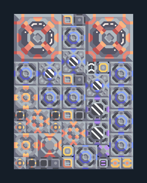

# อิมแพกต์ — ติดคลัง 2 เครื่อง

**POWER114** · 04 ไฟฟ้า · 10×13 ช่อง · **ตรวจผัง**

ไฟท้ายเกมแบบขยายจาก Core พร้อมวัตถุดิบและไครโอ  
ต่อ Unloader ชิด Core/คลังที่มีทราย ถ่านหิน ตะกั่ว ไทเทเนียม; น้ำจากพื้น; เริ่มด้วยไฟภายนอกและแบตเตอรี่ ใช้ logic ช่วยประหยัดไฟและ overdrive  
มี mlog เดิมฝังในแบบ: ห้ามลบ processor หากยังใช้ระบบอัตโนมัติ; ดูวิธีตั้งค่าของผู้สร้างในคู่มือฉบับเต็ม  
  
แหล่ง: Design-It / wpx  
ต้นฉบับ: 2 impacts on core (130) logicless  
MIT; แปลชื่อและคู่มือโดยชุด Serpulo ไทย 2.0  
อ่าน/โครงสร้างผ่านแล้ว ผลทดสอบการทำงานเฉพาะรหัสอยู่ในคู่มือ อัตราจริงขึ้นกับแผนที่และวัตถุดิบ  
  
หมวด: 04 ไฟฟ้า • Serpulo ไทย 2.0

**วัสดุก่อสร้าง:** ทองแดง 548 · กราไฟต์ 1115 · ตะกั่ว 1877 · เมตากลาส 771 · ผ้าเฟส 20 · พลาสตาเนียม 30 · ซิลิคอน 983 · เซิร์จอัลลอย 500 · ทอเรียม 200 · ไทเทเนียม 370

[ดาวน์โหลด .msch](../../schematics/POWER114.msch) · [รหัสนำเข้าจากคลิปบอร์ด](../../codes/POWER114.txt) · [กลับสารบัญ](../INDEX.md)

ภาพประกอบใช้กราฟิกบล็อกจากตัวเกม ไม่ใช่ภาพการรบระหว่างเล่นจริง ทางป้อนต้องจ่ายวัตถุดิบและไฟตามเงื่อนไขที่ระบุ
