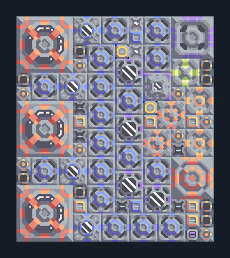

# อิมแพกต์ — เหมืองทรายและคลัง 3 เครื่อง

**POWER115** · 04 ไฟฟ้า · 14×16 ช่อง · **ตรวจผัง**

ระบบไฟขยายพร้อมผลิตเชื้อเพลิงและไครโอในตัว  
วาง Laser Drill บนทราย ต่อวัตถุดิบที่เหลือจาก Core/คลัง ตรวจพื้น Water Extractor; เริ่มด้วยไฟภายนอกและแบตเตอรี่; ไม่มี processor  
  
แหล่ง: Design-It / justacommonegg  
ต้นฉบับ: Impact Core LT on S 03  
MIT; แปลชื่อและคู่มือโดยชุด Serpulo ไทย 2.0  
อ่าน/โครงสร้างผ่านแล้ว ผลทดสอบการทำงานเฉพาะรหัสอยู่ในคู่มือ อัตราจริงขึ้นกับแผนที่และวัตถุดิบ  
  
หมวด: 04 ไฟฟ้า • Serpulo ไทย 2.0

**วัสดุก่อสร้าง:** ทองแดง 800 · กราไฟต์ 1853 · ตะกั่ว 2863 · เมตากลาส 1316 · ผ้าเฟส 40 · พลาสตาเนียม 80 · ซิลิคอน 1586 · เซิร์จอัลลอย 870 · ทอเรียม 300 · ไทเทเนียม 670

[ดาวน์โหลด .msch](../../schematics/POWER115.msch) · [รหัสนำเข้าจากคลิปบอร์ด](../../codes/POWER115.txt) · [กลับสารบัญ](../INDEX.md)

ภาพประกอบใช้กราฟิกบล็อกจากตัวเกม ไม่ใช่ภาพการรบระหว่างเล่นจริง ทางป้อนต้องจ่ายวัตถุดิบและไฟตามเงื่อนไขที่ระบุ
