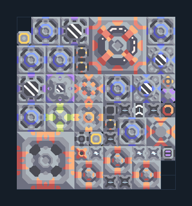

# อิมแพกต์ — เศษวัสดุครบระบบ

**POWER116** · 04 ไฟฟ้า · 11×12 ช่อง · **ตรวจผัง**

แปลง Scrap เป็นเชื้อเพลิง ไครโอ และไฟ  
วาง Airblast บน Scrap น้ำจากพื้น; จ่ายไฟเริ่มต้นจนเชื้อเพลิงและไครโอพร้อม ตัวควบคุม UniPlant เดิมดูแล startup; ห้ามตัดสายภายในหรือปิด processor  
มี mlog เดิมฝังในแบบ: ห้ามลบ processor หากยังใช้ระบบอัตโนมัติ; ดูวิธีตั้งค่าของผู้สร้างในคู่มือฉบับเต็ม  
  
แหล่ง: Design-It / cirrocco  
ต้นฉบับ: CCER ScrapImpact1 v1.8  
MIT; แปลชื่อและคู่มือโดยชุด Serpulo ไทย 2.0  
อ่าน/โครงสร้างผ่านแล้ว ผลทดสอบการทำงานเฉพาะรหัสอยู่ในคู่มือ อัตราจริงขึ้นกับแผนที่และวัตถุดิบ  
  
หมวด: 04 ไฟฟ้า • Serpulo ไทย 2.0

**วัสดุก่อสร้าง:** ทองแดง 662 · กราไฟต์ 717 · ตะกั่ว 1285 · เมตากลาส 485 · พลาสตาเนียม 30 · ซิลิคอน 645 · เซิร์จอัลลอย 250 · ทอเรียม 175 · ไทเทเนียม 385

[ดาวน์โหลด .msch](../../schematics/POWER116.msch) · [รหัสนำเข้าจากคลิปบอร์ด](../../codes/POWER116.txt) · [กลับสารบัญ](../INDEX.md)

ภาพประกอบใช้กราฟิกบล็อกจากตัวเกม ไม่ใช่ภาพการรบระหว่างเล่นจริง ทางป้อนต้องจ่ายวัตถุดิบและไฟตามเงื่อนไขที่ระบุ
